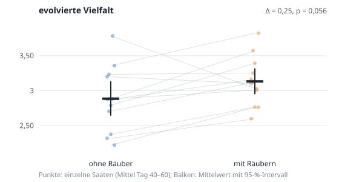
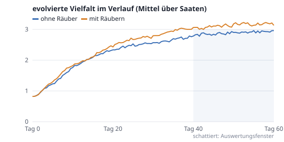
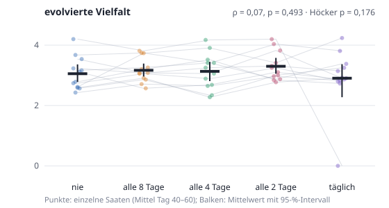
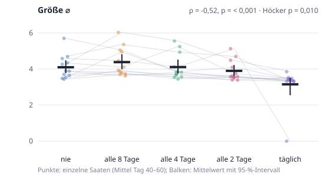
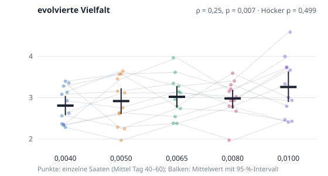

# Versuche im Gezeitenbecken

Vier Versuche und eine Replikation, alle mit `tools/experiment.mjs` gerechnet
und vollständig reproduzierbar. Die Rohdaten, Diagramme und Einzelberichte
stehen in `results/<versuch>/`, das Modell ist in [`MODELL.md`](MODELL.md)
beschrieben.

**Was man daraus lernen kann und was nicht.** Die Ergebnisse gelten für
*dieses* Modell: eine kleine Welt, ungeschlechtliche Vermehrung, eine einzige
Nahrungsquelle, 30 bis 45 Generationen. Sie zeigen, welche Muster aus diesen
Zutaten entstehen und welche nicht. Für echte Ökosysteme sind sie Hypothesen,
keine Belege.

## Gemeinsamer Aufbau

- **Gepaarte Saaten.** Jede Saat läuft auf jeder Stufe des Faktors, so dass
  Unterschiede innerhalb derselben Startwelt verglichen werden.
- **Einlaufphase.** In den ersten 10 Tagen dürfen bei Bedarf Einwanderer
  kommen, damit jede Welt anläuft. Danach ist das Becken geschlossen. Störungen
  beginnen ebenfalls erst an Tag 10.
- **Messfenster.** 60 Tage Laufzeit, ausgewertet wird der Mittelwert über die
  Tage 40 bis 60. Vorher steigt die Vielfalt noch an (siehe
  Verlaufsdiagramme).
- **Primäre Messgröße.** Vorab festgelegt ist die *evolvierte Vielfalt*: der
  mittlere Erbgut-Abstand zwischen Tieren derselben Gründerlinie, also die
  Vielfalt, die im Becken durch Mutation entstanden ist. Alle anderen Größen
  sind explorativ.
- **Statistik.**
  - Mittelwerte mit 95-%-Bootstrap-Intervall.
  - Bei zwei Stufen ein exakter Vorzeichen-Permutationstest der gepaarten
    Differenzen.
  - Bei mehreren Stufen ein Trendtest (Spearman, Permutation innerhalb jeder
    Saat) und ein vorab festgelegter Höckertest (innere gegen äußere Stufen).
  - p-Werte zusätzlich Holm-korrigiert über alle Messgrößen eines Versuchs.

## Ergebnisse auf einen Blick

| Versuch | Hypothese | Ergebnis für die primäre Messgröße |
| --- | --- | --- |
| Artschwelle (Kontrolle) | Artenzahl hängt von der Definition ab, Dynamik nicht | bestätigt, exakt |
| Räuber | Räuber erhöhen die Vielfalt | Tendenz dafür, siehe Replikation |
| Störung | Vielfalt am größten bei mittlerer Störung | nicht bestätigt |
| Produktivität | Vielfalt am größten bei mittlerer Produktivität | nicht bestätigt; stattdessen steigt sie stetig |

Der wichtigste Befund ist methodisch: **Gezählte Arten messen in diesem Modell
vor allem Bestandsgröße und Generationenumschlag, nicht Vielfalt.** Mehr dazu
in Befund 5.

---

## 1. Kontrollversuch: Artschwelle

*Prüft die Messung, nicht die Ökologie.* Die Artschwelle legt fest, ab welchem
Erbgut-Abstand eine Linie als neue Art zählt. Sie ist eine Beobachtungsgröße
und darf die Dynamik nicht beeinflussen.

| Artschwelle | 2,0 | 2,5 | 3,0 | 3,5 |
| --- | --- | --- | --- | --- |
| Artenzahl | 19,9 | 15,4 | 9,3 | 8,0 |
| effektive Arten | 10,1 | 6,7 | 4,3 | 4,0 |
| evolvierte Vielfalt | 2,84 | 2,84 | 2,84 | 2,84 |
| Tiere | 569 | 569 | 569 | 569 |

Dynamik und Vielfalt sind auf allen Stufen bitgenau gleich, die gezählte
Artenzahl ändert sich um den Faktor 2,5. Deshalb verwenden alle weiteren
Versuche die evolvierte Vielfalt als primäre Messgröße.
→ [Bericht](results/artschwelle/bericht.md)

## 2. Räuber (Schlüsselräuber-Hypothese)

**Hypothese** (nach Paine 1966): Wo Angriffe möglich sind, ist die Vielfalt
höher, weil Räuber dominante Linien kurz halten. Der Faktor schaltet nur die
Wirkung des Angriffsausgangs ab; Gehirne und Kosten bleiben gleich.

| 12 Saaten | ohne Räuber | mit Räubern | Differenz [95 %] | p | p (Holm) |
| --- | --- | --- | --- | --- | --- |
| **evolvierte Vielfalt** | 2,89 | 3,13 | +0,25 [0,02; 0,44] | 0,056 | 0,30 |
| Tiere | 749 | 580 | −169 [−286; −34] | 0,041 | 0,29 |
| Artenzahl | 18,7 | 14,6 | −4,1 [−7,6; −0,6] | 0,050 | 0,30 |

In 10 von 12 Saaten war die evolvierte Vielfalt mit Räubern höher. Die Kurven
laufen bis etwa Tag 15 zusammen und trennen sich dann. Die Effektstärke ist
mittel (d_z = 0,63), der Test mit 12 Saaten aber knapp nicht signifikant.
Deshalb gibt es eine vorab festgelegte Replikation (Abschnitt 2a).

Auffällig: Mit Räubern gibt es *weniger* gezählte Arten, aber *mehr*
evolvierte Vielfalt. Die beiden Maße zeigen in entgegengesetzte Richtungen
(siehe Befund 5).

### 2a. Replikation

<!-- REPLIKATION -->

## 3. Störung (Intermediate Disturbance Hypothesis)

**Hypothese** (nach Connell 1978): Die Vielfalt ist bei mittlerer
Störungshäufigkeit am größten. Eine Störung tötet jedes Tier unabhängig von
seinem Zustand mit 50 % Wahrscheinlichkeit, wie ein Sturm.

| 12 Saaten je Stufe | nie | alle 8 Tage | alle 4 Tage | alle 2 Tage | täglich | Test |
| --- | --- | --- | --- | --- | --- | --- |
| **evolvierte Vielfalt** | 3,05 | 3,17 | 3,13 | 3,30 | 2,90 | Höcker p = 0,18; Trend ρ = 0,07, p = 0,49 |
| Größe ⌀ | 4,10 | 4,38 | 4,11 | 3,90 | 3,15 | Trend ρ = −0,52, p < 0,001 (Holm) |
| effektive Arten | 7,2 | 8,2 | 8,7 | 10,9 | 12,8 | Trend ρ = 0,47, p < 0,001 (Holm) |
| höchste Generation | 34 | 36 | 35 | 39 | 47 | |
| Geburten bis Tag 60 | 7 800 | 8 000 | 9 600 | 12 500 | 17 600 | |

**Die Hypothese ist nicht bestätigt.** Die Daten haben zwar eine Form, die
nach einem Höcker aussieht (Spitze bei „alle 2 Tage“, Einbruch bei
„täglich“), aber der vorab festgelegte Test findet keinen belastbaren
Höcker. Eine von zwölf täglich gestörten Welten starb aus.

Zwei andere Effekte sind dagegen deutlich:

- **Häufige Störung macht die Tiere kleiner** (4,1 → 3,2). Das passt zur
  Lebenszyklus-Theorie (r/K-Selektion, MacArthur & Wilson 1967): Wo der Tod
  zufällig und häufig kommt, gewinnt, wer sich früh teilt. Im Modell erreichen
  kleine Tiere die Teilungsschwelle schneller, weil ihr Energiebedarf mit s²,
  ihr Ertrag aber nur mit s^1,7 wächst. Das ist eine Deutung, die der Versuch
  nahelegt, aber nicht beweist; ein Folgeversuch könnte das Alter bei der
  ersten Teilung messen.
- **Die gezählte Artenzahl steigt stark, die Vielfalt nicht.** Störung
  verdoppelt die Zahl der Geburten. Mehr Geburten bedeuten mehr Kinder, die
  die Artschwelle überschreiten, also mehr gezählte Arten, ohne dass die
  Gemeinschaft genetisch vielfältiger wird.

→ [Bericht](results/stoerung/bericht.md)

## 4. Produktivität

**Hypothese:** Die Vielfalt ist bei mittlerer Produktivität am größten (eine in
vielen Ökosystemen beobachtete Höckerform). Faktor ist die Wachstumsrate der
Algen.

| 12 Saaten je Stufe | 0,0040 | 0,0050 | 0,0065 | 0,0080 | 0,0100 | Test |
| --- | --- | --- | --- | --- | --- | --- |
| **evolvierte Vielfalt** | 2,81 | 2,92 | 3,02 | 2,98 | 3,26 | Trend ρ = 0,25, p (Holm) = 0,021; Höcker p = 0,50 |
| Tiere | 308 | 408 | 636 | 615 | 773 | Trend ρ = 0,63, p < 0,001 |
| Jägeranteil | 5 % | 5 % | 6 % | 10 % | 11 % | Trend ρ = 0,50, p < 0,001 |
| Artenzahl | 9,5 | 12,2 | 17,5 | 17,8 | 24,0 | Trend ρ = 0,71, p < 0,001 |

**Kein Höcker, sondern ein stetiger Anstieg.** Mehr Futter bedeutet mehr Tiere,
und die evolvierte Vielfalt steigt mit. Das passt zur populationsgenetischen
Erwartung, dass größere Populationen mehr Variation halten, weil mehr
Mutationen entstehen und Drift weniger verliert. Ob die Produktivität *über*
die Bestandsgröße wirkt oder auf anderem Weg, trennt dieser Versuch nicht. Dazu
müsste man die Bestandsgröße unabhängig festhalten, etwa durch ein größeres
Becken bei gleicher Produktivität.

**Mehr Futter, mehr Jäger.** Der Anteil der Tiere mit mindestens einer Beute
verdoppelt sich. Das entspricht der Idee, dass produktivere Systeme höhere
Ebenen der Nahrungskette tragen können (Oksanen et al. 1981).

→ [Bericht](results/produktivitaet/bericht.md)

## 5. Befund über die Messung: Artenzahlen täuschen

In allen drei ökologischen Versuchen laufen die gezählte Artenzahl und die
evolvierte Vielfalt auseinander:

| | gezählte Arten | evolvierte Vielfalt |
| --- | --- | --- |
| mehr Räuber | sinkt | steigt (Tendenz) |
| mehr Störung | steigt stark | kein Effekt |
| mehr Produktivität | steigt stark (×2,5) | steigt schwach (+16 %) |

Der Grund liegt in der Messung. Eine Linie zählt als Art, sobald sie
einmal zehn Tiere erreicht. Mehr Tiere und mehr Geburten erzeugen deshalb mehr
gezählte Arten, unabhängig davon, wie verschieden die Tiere sind. Dasselbe
Problem kennt die Feldökologie: Wer mehr Individuen sammelt, findet mehr
Arten, deshalb vergleicht man dort Artenzahlen nur bei gleicher
Stichprobengröße (Rarefaction, Gotelli & Colwell 2001).

**Folgerung für Arbeit mit dem Modell:** Für Fragen zur Vielfalt die
evolvierte oder die genetische Vielfalt verwenden. Artenzahlen nur
gemeinsam mit der Bestandsgröße berichten.

## Offene Fragen und nächste Versuche

- **Größe gegen Produktivität trennen:** gleiches Futter pro Fläche, aber
  größere Welt.
- **Schrumpfen unter Störung erklären:** Alter bei der ersten Teilung und
  Zahl der Nachkommen messen.
- **Länger rechnen:** Die Läufe umfassen 30 bis 45 Generationen. Ob die
  Unterschiede wachsen oder verschwinden, zeigen erst Läufe über 200 Tage.
- **Robustheit:** die Hauptversuche mit anderen Werten für Abstandsgewichte,
  Mutationsfaktor und Weltgröße wiederholen.

## Quellen

- Connell, J. H. (1978): Diversity in tropical rain forests and coral reefs.
  *Science* 199, 1302–1310.
- Gotelli, N. J. & Colwell, R. K. (2001): Quantifying biodiversity: procedures
  and pitfalls in the measurement and comparison of species richness.
  *Ecology Letters* 4, 379–391.
- MacArthur, R. H. & Wilson, E. O. (1967): *The Theory of Island
  Biogeography.* Princeton University Press.
- Oksanen, L., Fretwell, S. D., Arruda, J. & Niemelä, P. (1981): Exploitation
  ecosystems in gradients of primary productivity. *American Naturalist* 118,
  240–261.
- Paine, R. T. (1966): Food web complexity and species diversity.
  *American Naturalist* 100, 65–75.
