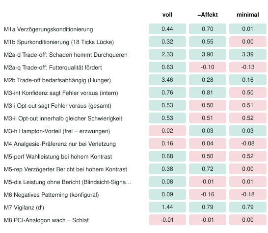
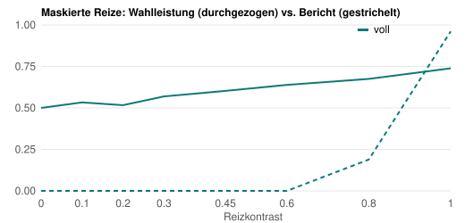
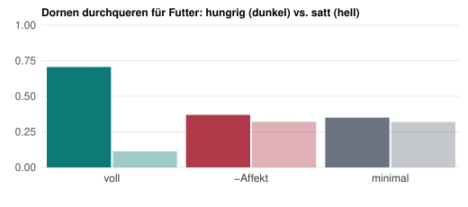

# Ergebnisse der Markerstudie (automatisch erzeugt)

Erzeugt aus `results/study.json` (2026-11-26T00:30:57.071Z). N = 36 Individuen, 3 Bedingungen. Ausgeschlossen (bei der Aufzucht gestorben): voll: 0, −Affekt: 0, minimal: 0.

Zelle: Mittelwert [95-%-Bootstrap-KI]; **fett** = bestanden (KI schließt Nullniveau aus); g = Hedges g gegenüber »voll«.

| Marker | Null | voll | −Affekt | minimal |
|---|---|---|---|---|
| M1a Verzögerungskonditionierung | 0 | **0.44 [0.42, 0.47]** | **0.70 [0.66, 0.74] g=4.0** | **0.01 [0.00, 0.02] g=-12.2** |
| M1b Spurkonditionierung (18 Ticks Lücke) | 0 | **0.32 [0.31, 0.34]** | **0.55 [0.50, 0.60] g=3.5** | 0.00 [-0.01, 0.01] g=-12.2 |
| M2a-d Trade-off: Schaden hemmt Durchqueren | 0 | **2.33 [1.99, 2.71]** | **3.90 [3.51, 4.34] g=2.1** | **3.39 [3.01, 3.82] g=1.5** |
| M2a-q Trade-off: Futterqualität fördert | 0 | **0.63 [0.50, 0.76]** | -0.10 [-0.20, 0.01] g=-3.2 | -0.13 [-0.25, -0.01] g=-3.2 |
| M2b Trade-off bedarfsabhängig (Hunger) | 0 | **3.46 [3.20, 3.79]** | **0.28 [0.17, 0.41] g=-7.3** | **0.16 [0.06, 0.27] g=-7.8** |
| M3-int Konfidenz sagt Fehler voraus (intern) | 0.5 | **0.76 [0.75, 0.77]** | **0.81 [0.80, 0.82] g=2.1** | 0.50 [0.50, 0.50] g=-17.2 |
| M3-i Opt-out sagt Fehler voraus (gesamt) | 0.5 | **0.53 [0.52, 0.54]** | 0.50 [0.48, 0.52] g=-1.1 | 0.51 [0.49, 0.53] g=-0.7 |
| M3-ii Opt-out innerhalb gleicher Schwierigkeit | 0.5 | **0.53 [0.52, 0.54]** | 0.51 [0.48, 0.54] g=-0.5 | 0.52 [0.49, 0.55] g=-0.2 |
| M3-h Hampton-Vorteil (frei − erzwungen) | 0 | 0.02 [-0.01, 0.05] | **0.03 [0.01, 0.05] g=0.3** | **0.03 [0.01, 0.05] g=0.3** |
| M4 Analgesie-Präferenz nur bei Verletzung | 0 | 0.16 [-0.16, 0.48] | 0.04 [-0.25, 0.35] g=-0.2 | -0.08 [-0.37, 0.21] g=-0.4 |
| M5-perf Wahlleistung bei hohem Kontrast | 0.5 | **0.68 [0.66, 0.70]** | 0.50 [0.48, 0.53] g=-4.2 | 0.52 [0.49, 0.54] g=-3.7 |
| M5-rep Verzögerter Bericht bei hohem Kontrast | 0 | **0.38 [0.31, 0.45]** | **0.72 [0.62, 0.82] g=2.1** | 0.00 [0.00, 0.00] g=-3.8 |
| M5-dis Leistung ohne Bericht (Blindsicht-Signatur) | 0 | **0.08 [0.07, 0.10]** | -0.01 [-0.04, 0.01] g=-2.3 | 0.01 [-0.00, 0.02] g=-2.6 |
| M6 Negatives Patterning (konfigural) | 0 | **0.09 [0.09, 0.09]** | -0.16 [-0.26, -0.05] g=-1.6 | -0.18 [-0.18, -0.18] g=-178.8 |
| M7 Vigilanz (d′) | 0 | **1.44 [1.26, 1.60]** | **0.79 [0.78, 0.80] g=-2.8** | **0.79 [0.78, 0.80] g=-2.8** |
| M8 PCI-Analogon wach − Schlaf | 0 | -0.01 [-0.02, 0.00] | -0.01 [-0.02, 0.00] g=-0.2 | 0.00 [0.00, 0.00] g=0.5 |

## Fitness in der natürlichen Welt (M9)

| Kennzahl | voll | −Affekt | minimal |
|---|---|---|---|
| Überleben 30 000 Ticks (natürliche Welt) | 1.00 [1.00, 1.00] | 0.00 [0.00, 0.00] | 0.00 [0.00, 0.00] |
| Mittlerer homöostatischer Antrieb D | 0.16 [0.15, 0.17] | 0.43 [0.39, 0.46] | 0.39 [0.36, 0.43] |
| Lebensdauer | 30000 [30000, 30000] | 2144 [1604, 2752] | 2108 [1838, 2419] |

Todesursachen: voll: –; −Affekt: Erfroren/Überhitzt, Erfroren/Überhitzt, Verletzungen, Erfroren/Überhitzt, Erfroren/Überhitzt, Verletzungen, Erfroren/Überhitzt, Erfroren/Überhitzt, Erfroren/Überhitzt, Erfroren/Überhitzt, Erfroren/Überhitzt, Erfroren/Überhitzt; minimal: Erfroren/Überhitzt, Erfroren/Überhitzt, Erfroren/Überhitzt, Erfroren/Überhitzt, Erfroren/Überhitzt, Erfroren/Überhitzt, Erfroren/Überhitzt, Erfroren/Überhitzt, Erfroren/Überhitzt, Erfroren/Überhitzt, Erfroren/Überhitzt, Erfroren/Überhitzt

## Cluster-Test

Korrelationsmatrix der 10 Marker-Kennzahlen über 36 Individuen. Erster Hauptfaktor erklärt **37.6 %** der Varianz; Eigenwerte > 1: **3**.

Eigenwerte: 3.76, 2.91, 1.17, 0.81, 0.57, 0.31, 0.27, 0.12, 0.07, 0.02

Ladungen PC1: M1a 0.07, M1b 0.02, M2a-d -0.38, M2b 0.47, M3-i 0.26, M4 0.06, M5-rep 0.01, M5-dis 0.42, M6 0.41, M7 0.46

| | M1a | M1b | M2a-d | M2b | M3-i | M4 | M5-rep | M5-dis | M6 | M7 |
|---|---|---|---|---|---|---|---|---|---|---|
| M1a | 1.00 | 0.94 | 0.16 | 0.19 | -0.02 | 0.11 | 0.91 | -0.05 | 0.22 | 0.13 |
| M1b | 0.94 | 1.00 | 0.17 | 0.12 | -0.04 | 0.16 | 0.87 | -0.11 | 0.00 | 0.08 |
| M2a-d | 0.16 | 0.17 | 1.00 | -0.56 | -0.31 | 0.01 | 0.11 | -0.50 | -0.50 | -0.70 |
| M2b | 0.19 | 0.12 | -0.56 | 1.00 | 0.35 | 0.11 | 0.04 | 0.74 | 0.72 | 0.82 |
| M3-i | -0.02 | -0.04 | -0.31 | 0.35 | 1.00 | 0.10 | -0.09 | 0.46 | 0.25 | 0.29 |
| M4 | 0.11 | 0.16 | 0.01 | 0.11 | 0.10 | 1.00 | -0.02 | 0.16 | -0.17 | 0.20 |
| M5-rep | 0.91 | 0.87 | 0.11 | 0.04 | -0.09 | -0.02 | 1.00 | -0.19 | 0.16 | 0.02 |
| M5-dis | -0.05 | -0.11 | -0.50 | 0.74 | 0.46 | 0.16 | -0.19 | 1.00 | 0.56 | 0.60 |
| M6 | 0.22 | 0.00 | -0.50 | 0.72 | 0.25 | -0.17 | 0.16 | 0.56 | 1.00 | 0.61 |
| M7 | 0.13 | 0.08 | -0.70 | 0.82 | 0.29 | 0.20 | 0.02 | 0.60 | 0.61 | 1.00 |

## Abbildungen

