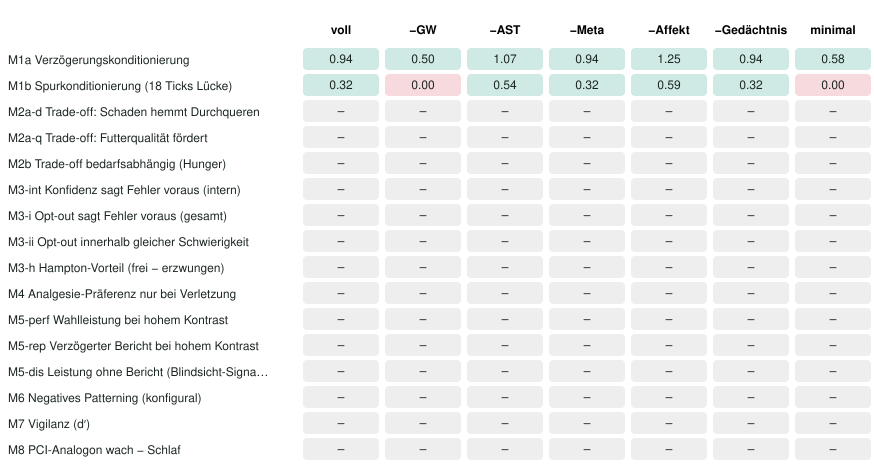
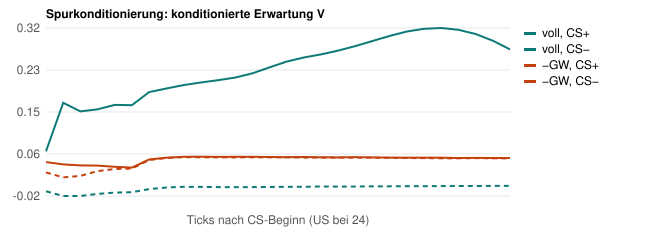
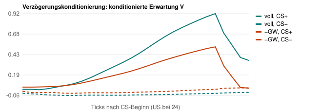

# Ergebnisse der Markerstudie (automatisch erzeugt)

Erzeugt aus `results/study.json` (2026-11-26T00:33:54.108Z). N = 84 Individuen, 7 Bedingungen. Ausgeschlossen (bei der Aufzucht gestorben): voll: 0, −GW: 0, −AST: 0, −Meta: 0, −Affekt: 0, −Gedächtnis: 0, minimal: 0.

Zelle: Mittelwert [95-%-Bootstrap-KI]; **fett** = bestanden (KI schließt Nullniveau aus); g = Hedges g gegenüber »voll«.

| Marker | Null | voll | −GW | −AST | −Meta | −Affekt | −Gedächtnis | minimal |
|---|---|---|---|---|---|---|---|---|
| M1a Verzögerungskonditionierung | 0 | **0.94 [0.90, 0.98]** | **0.50 [0.48, 0.52] g=-8.0** | **1.07 [1.04, 1.11] g=1.9** | **0.94 [0.91, 0.98] g=0.0** | **1.25 [1.19, 1.30] g=3.5** | **0.94 [0.91, 0.97] g=-0.1** | **0.58 [0.55, 0.60] g=-6.0** |
| M1b Spurkonditionierung (18 Ticks Lücke) | 0 | **0.32 [0.30, 0.34]** | 0.00 [-0.01, 0.02] g=-9.7 | **0.54 [0.52, 0.56] g=5.6** | **0.32 [0.30, 0.34] g=0.0** | **0.59 [0.54, 0.64] g=4.1** | **0.32 [0.30, 0.34] g=0.0** | 0.00 [-0.02, 0.03] g=-8.4 |
| M2a-d Trade-off: Schaden hemmt Durchqueren | 0 | – [–, –] | – [–, –] g=– | – [–, –] g=– | – [–, –] g=– | – [–, –] g=– | – [–, –] g=– | – [–, –] g=– |
| M2a-q Trade-off: Futterqualität fördert | 0 | – [–, –] | – [–, –] g=– | – [–, –] g=– | – [–, –] g=– | – [–, –] g=– | – [–, –] g=– | – [–, –] g=– |
| M2b Trade-off bedarfsabhängig (Hunger) | 0 | – [–, –] | – [–, –] g=– | – [–, –] g=– | – [–, –] g=– | – [–, –] g=– | – [–, –] g=– | – [–, –] g=– |
| M3-int Konfidenz sagt Fehler voraus (intern) | 0.5 | – [–, –] | – [–, –] g=– | – [–, –] g=– | – [–, –] g=– | – [–, –] g=– | – [–, –] g=– | – [–, –] g=– |
| M3-i Opt-out sagt Fehler voraus (gesamt) | 0.5 | – [–, –] | – [–, –] g=– | – [–, –] g=– | – [–, –] g=– | – [–, –] g=– | – [–, –] g=– | – [–, –] g=– |
| M3-ii Opt-out innerhalb gleicher Schwierigkeit | 0.5 | – [–, –] | – [–, –] g=– | – [–, –] g=– | – [–, –] g=– | – [–, –] g=– | – [–, –] g=– | – [–, –] g=– |
| M3-h Hampton-Vorteil (frei − erzwungen) | 0 | – [–, –] | – [–, –] g=– | – [–, –] g=– | – [–, –] g=– | – [–, –] g=– | – [–, –] g=– | – [–, –] g=– |
| M4 Analgesie-Präferenz nur bei Verletzung | 0 | – [–, –] | – [–, –] g=– | – [–, –] g=– | – [–, –] g=– | – [–, –] g=– | – [–, –] g=– | – [–, –] g=– |
| M5-perf Wahlleistung bei hohem Kontrast | 0.5 | – [–, –] | – [–, –] g=– | – [–, –] g=– | – [–, –] g=– | – [–, –] g=– | – [–, –] g=– | – [–, –] g=– |
| M5-rep Verzögerter Bericht bei hohem Kontrast | 0 | – [–, –] | – [–, –] g=– | – [–, –] g=– | – [–, –] g=– | – [–, –] g=– | – [–, –] g=– | – [–, –] g=– |
| M5-dis Leistung ohne Bericht (Blindsicht-Signatur) | 0 | – [–, –] | – [–, –] g=– | – [–, –] g=– | – [–, –] g=– | – [–, –] g=– | – [–, –] g=– | – [–, –] g=– |
| M6 Negatives Patterning (konfigural) | 0 | – [–, –] | – [–, –] g=– | – [–, –] g=– | – [–, –] g=– | – [–, –] g=– | – [–, –] g=– | – [–, –] g=– |
| M7 Vigilanz (d′) | 0 | – [–, –] | – [–, –] g=– | – [–, –] g=– | – [–, –] g=– | – [–, –] g=– | – [–, –] g=– | – [–, –] g=– |
| M8 PCI-Analogon wach − Schlaf | 0 | – [–, –] | – [–, –] g=– | – [–, –] g=– | – [–, –] g=– | – [–, –] g=– | – [–, –] g=– | – [–, –] g=– |

## Fitness in der natürlichen Welt (M9)

| Kennzahl | voll | −GW | −AST | −Meta | −Affekt | −Gedächtnis | minimal |
|---|---|---|---|---|---|---|---|
| Überleben 30 000 Ticks (natürliche Welt) | – [–, –] | – [–, –] | – [–, –] | – [–, –] | – [–, –] | – [–, –] | – [–, –] |
| Mittlerer homöostatischer Antrieb D | – [–, –] | – [–, –] | – [–, –] | – [–, –] | – [–, –] | – [–, –] | – [–, –] |
| Lebensdauer | – [–, –] | – [–, –] | – [–, –] | – [–, –] | – [–, –] | – [–, –] | – [–, –] |

Todesursachen: voll: –; −GW: –; −AST: –; −Meta: –; −Affekt: –; −Gedächtnis: –; minimal: –

## Cluster-Test

Korrelationsmatrix der 10 Marker-Kennzahlen über 0 Individuen. Erster Hauptfaktor erklärt **10.0 %** der Varianz; Eigenwerte > 1: **0**.

Eigenwerte: 1.00, 1.00, 1.00, 1.00, 1.00, 1.00, 1.00, 1.00, 1.00, 1.00

Ladungen PC1: M1a 1.00, M1b 0.00, M2a-d 0.00, M2b 0.00, M3-i 0.00, M4 0.00, M5-rep 0.00, M5-dis 0.00, M6 0.00, M7 0.00

| | M1a | M1b | M2a-d | M2b | M3-i | M4 | M5-rep | M5-dis | M6 | M7 |
|---|---|---|---|---|---|---|---|---|---|---|
| M1a | 1.00 | – | – | – | – | – | – | – | – | – |
| M1b | – | 1.00 | – | – | – | – | – | – | – | – |
| M2a-d | – | – | 1.00 | – | – | – | – | – | – | – |
| M2b | – | – | – | 1.00 | – | – | – | – | – | – |
| M3-i | – | – | – | – | 1.00 | – | – | – | – | – |
| M4 | – | – | – | – | – | 1.00 | – | – | – | – |
| M5-rep | – | – | – | – | – | – | 1.00 | – | – | – |
| M5-dis | – | – | – | – | – | – | – | 1.00 | – | – |
| M6 | – | – | – | – | – | – | – | – | 1.00 | – |
| M7 | – | – | – | – | – | – | – | – | – | 1.00 |

## Abbildungen

