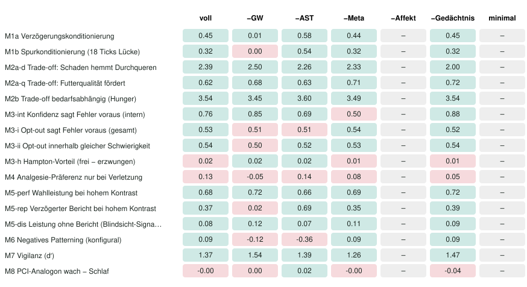
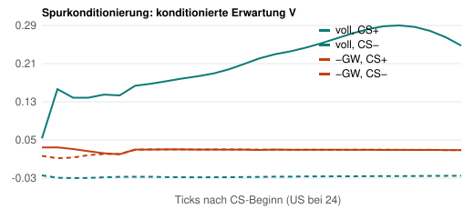
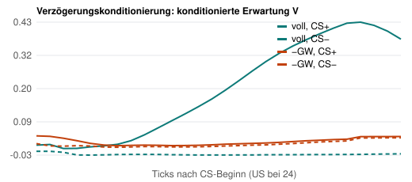
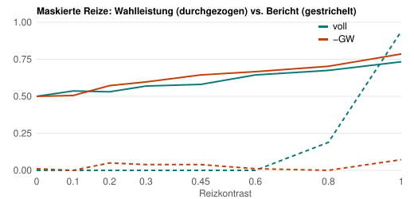
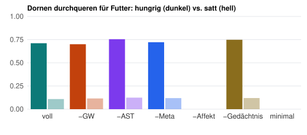

# Ergebnisse der Markerstudie (automatisch erzeugt)

Erzeugt aus `results/study.json` (2026-11-26T00:21:48.720Z). N = 84 Individuen, 7 Bedingungen. Ausgeschlossen (bei der Aufzucht gestorben): voll: 0, −GW: 0, −AST: 0, −Meta: 0, −Affekt: 12, −Gedächtnis: 0, minimal: 12.

Zelle: Mittelwert [95-%-Bootstrap-KI]; **fett** = bestanden (KI schließt Nullniveau aus); g = Hedges g gegenüber »voll«.

| Marker | Null | voll | −GW | −AST | −Meta | −Affekt | −Gedächtnis | minimal |
|---|---|---|---|---|---|---|---|---|
| M1a Verzögerungskonditionierung | 0 | **0.45 [0.42, 0.47]** | **0.01 [0.00, 0.01] g=-13.4** | **0.58 [0.56, 0.60] g=3.1** | **0.44 [0.42, 0.47] g=-0.1** | – [–, –] g=– | **0.45 [0.43, 0.48] g=0.2** | – [–, –] g=– |
| M1b Spurkonditionierung (18 Ticks Lücke) | 0 | **0.32 [0.31, 0.34]** | 0.00 [-0.01, 0.01] g=-13.6 | **0.54 [0.52, 0.56] g=6.9** | **0.32 [0.30, 0.33] g=-0.0** | – [–, –] g=– | **0.32 [0.30, 0.34] g=0.0** | – [–, –] g=– |
| M2a-d Trade-off: Schaden hemmt Durchqueren | 0 | **2.39 [2.07, 2.75]** | **2.50 [2.27, 2.71] g=0.2** | **2.26 [2.03, 2.47] g=-0.3** | **2.33 [2.05, 2.59] g=-0.1** | – [–, –] g=– | **2.00 [1.71, 2.29] g=-0.7** | – [–, –] g=– |
| M2a-q Trade-off: Futterqualität fördert | 0 | **0.62 [0.49, 0.75]** | **0.68 [0.51, 0.82] g=0.2** | **0.63 [0.52, 0.74] g=0.1** | **0.71 [0.55, 0.87] g=0.3** | – [–, –] g=– | **0.72 [0.55, 0.92] g=0.3** | – [–, –] g=– |
| M2b Trade-off bedarfsabhängig (Hunger) | 0 | **3.54 [3.31, 3.85]** | **3.45 [3.22, 3.67] g=-0.2** | **3.60 [3.36, 3.83] g=0.1** | **3.49 [3.30, 3.68] g=-0.1** | – [–, –] g=– | **3.54 [3.31, 3.80] g=-0.0** | – [–, –] g=– |
| M3-int Konfidenz sagt Fehler voraus (intern) | 0.5 | **0.76 [0.75, 0.77]** | **0.85 [0.84, 0.86] g=4.6** | **0.69 [0.67, 0.71] g=-2.0** | 0.50 [0.50, 0.50] g=-17.2 | – [–, –] g=– | **0.88 [0.87, 0.88] g=6.6** | – [–, –] g=– |
| M3-i Opt-out sagt Fehler voraus (gesamt) | 0.5 | **0.53 [0.52, 0.54]** | 0.51 [0.50, 0.53] g=-0.8 | 0.51 [0.50, 0.53] g=-0.7 | **0.54 [0.53, 0.55] g=0.4** | – [–, –] g=– | **0.52 [0.51, 0.54] g=-0.3** | – [–, –] g=– |
| M3-ii Opt-out innerhalb gleicher Schwierigkeit | 0.5 | **0.54 [0.52, 0.55]** | 0.50 [0.47, 0.52] g=-1.0 | **0.52 [0.50, 0.53] g=-0.6** | **0.53 [0.52, 0.55] g=-0.1** | – [–, –] g=– | **0.54 [0.51, 0.57] g=0.0** | – [–, –] g=– |
| M3-h Hampton-Vorteil (frei − erzwungen) | 0 | 0.02 [-0.01, 0.05] | **0.02 [0.01, 0.04] g=0.1** | **0.02 [0.00, 0.04] g=0.1** | 0.01 [-0.01, 0.03] g=-0.2 | – [–, –] g=– | 0.01 [-0.00, 0.02] g=-0.2 | – [–, –] g=– |
| M4 Analgesie-Präferenz nur bei Verletzung | 0 | 0.13 [-0.22, 0.46] | -0.05 [-0.30, 0.19] g=-0.3 | 0.14 [-0.04, 0.31] g=0.0 | 0.08 [-0.16, 0.31] g=-0.1 | – [–, –] g=– | 0.05 [-0.16, 0.25] g=-0.1 | – [–, –] g=– |
| M5-perf Wahlleistung bei hohem Kontrast | 0.5 | **0.68 [0.66, 0.70]** | **0.72 [0.70, 0.74] g=0.8** | **0.66 [0.63, 0.70] g=-0.4** | **0.69 [0.67, 0.71] g=0.1** | – [–, –] g=– | **0.72 [0.70, 0.74] g=0.9** | – [–, –] g=– |
| M5-rep Verzögerter Bericht bei hohem Kontrast | 0 | **0.37 [0.30, 0.45]** | 0.02 [-0.05, 0.10] g=-2.5 | **0.69 [0.66, 0.71] g=3.0** | **0.35 [0.29, 0.40] g=-0.2** | – [–, –] g=– | **0.39 [0.32, 0.46] g=0.1** | – [–, –] g=– |
| M5-dis Leistung ohne Bericht (Blindsicht-Signatur) | 0 | **0.08 [0.06, 0.10]** | **0.12 [0.09, 0.15] g=0.9** | **0.07 [0.04, 0.09] g=-0.3** | **0.11 [0.08, 0.14] g=0.6** | – [–, –] g=– | **0.09 [0.06, 0.11] g=0.1** | – [–, –] g=– |
| M6 Negatives Patterning (konfigural) | 0 | **0.09 [0.09, 0.09]** | -0.12 [-0.12, -0.12] g=-198.3 | -0.36 [-0.36, -0.35] g=-384.0 | **0.09 [0.09, 0.09] g=0.5** | – [–, –] g=– | **0.09 [0.09, 0.09] g=0.5** | – [–, –] g=– |
| M7 Vigilanz (d′) | 0 | **1.37 [1.17, 1.57]** | **1.54 [1.42, 1.65] g=0.5** | **1.39 [1.27, 1.52] g=0.1** | **1.26 [1.11, 1.41] g=-0.3** | – [–, –] g=– | **1.47 [1.36, 1.58] g=0.3** | – [–, –] g=– |
| M8 PCI-Analogon wach − Schlaf | 0 | -0.00 [-0.01, 0.00] | 0.00 [0.00, 0.00] g=0.4 | **0.02 [0.01, 0.03] g=1.2** | -0.00 [-0.01, 0.01] g=0.2 | – [–, –] g=– | -0.04 [-0.05, -0.03] g=-1.7 | – [–, –] g=– |

## Fitness in der natürlichen Welt (M9)

| Kennzahl | voll | −GW | −AST | −Meta | −Affekt | −Gedächtnis | minimal |
|---|---|---|---|---|---|---|---|
| Überleben 30 000 Ticks (natürliche Welt) | 1.00 [1.00, 1.00] | 0.75 [0.50, 1.00] | 0.92 [0.75, 1.00] | 0.92 [0.75, 1.00] | 0.00 [0.00, 0.00] | 0.83 [0.58, 1.00] | 0.00 [0.00, 0.00] |
| Mittlerer homöostatischer Antrieb D | 0.16 [0.15, 0.17] | 0.20 [0.14, 0.29] | 0.17 [0.15, 0.21] | 0.17 [0.15, 0.21] | 0.43 [0.39, 0.46] | 0.17 [0.14, 0.23] | 0.39 [0.36, 0.43] |
| Lebensdauer | 30000 [30000, 30000] | 23735 [17221, 30000] | 27715 [23145, 30000] | 27930 [23790, 30000] | 2144 [1604, 2752] | 27646 [23133, 30000] | 2108 [1838, 2419] |

Todesursachen: voll: –; −GW: Verdurstet, Verletzungen, Verdurstet; −AST: Verletzungen; −Meta: Verletzungen; −Affekt: Erfroren/Überhitzt, Erfroren/Überhitzt, Verletzungen, Erfroren/Überhitzt, Erfroren/Überhitzt, Verletzungen, Erfroren/Überhitzt, Erfroren/Überhitzt, Erfroren/Überhitzt, Erfroren/Überhitzt, Erfroren/Überhitzt, Erfroren/Überhitzt; −Gedächtnis: Verletzungen, Verletzungen; minimal: Erfroren/Überhitzt, Erfroren/Überhitzt, Erfroren/Überhitzt, Erfroren/Überhitzt, Erfroren/Überhitzt, Erfroren/Überhitzt, Erfroren/Überhitzt, Erfroren/Überhitzt, Erfroren/Überhitzt, Erfroren/Überhitzt, Erfroren/Überhitzt, Erfroren/Überhitzt

## Cluster-Test

Korrelationsmatrix der 10 Marker-Kennzahlen über 60 Individuen. Erster Hauptfaktor erklärt **31.9 %** der Varianz; Eigenwerte > 1: **4**.

Eigenwerte: 3.19, 1.59, 1.32, 1.02, 0.86, 0.67, 0.65, 0.53, 0.14, 0.03

Ladungen PC1: M1a 0.52, M1b 0.53, M2a-d -0.10, M2b 0.10, M3-i 0.05, M4 0.11, M5-rep 0.52, M5-dis -0.30, M6 -0.17, M7 -0.17

| | M1a | M1b | M2a-d | M2b | M3-i | M4 | M5-rep | M5-dis | M6 | M7 |
|---|---|---|---|---|---|---|---|---|---|---|
| M1a | 1.00 | 0.94 | -0.19 | 0.12 | 0.13 | 0.14 | 0.82 | -0.35 | -0.04 | -0.22 |
| M1b | 0.94 | 1.00 | -0.14 | 0.13 | 0.08 | 0.10 | 0.87 | -0.34 | -0.29 | -0.21 |
| M2a-d | -0.19 | -0.14 | 1.00 | 0.28 | -0.17 | -0.23 | -0.18 | 0.01 | -0.05 | -0.22 |
| M2b | 0.12 | 0.13 | 0.28 | 1.00 | -0.06 | -0.06 | 0.15 | -0.04 | -0.06 | -0.15 |
| M3-i | 0.13 | 0.08 | -0.17 | -0.06 | 1.00 | 0.14 | 0.02 | -0.02 | 0.28 | -0.06 |
| M4 | 0.14 | 0.10 | -0.23 | -0.06 | 0.14 | 1.00 | 0.04 | -0.19 | -0.02 | -0.02 |
| M5-rep | 0.82 | 0.87 | -0.18 | 0.15 | 0.02 | 0.04 | 1.00 | -0.41 | -0.35 | -0.19 |
| M5-dis | -0.35 | -0.34 | 0.01 | -0.04 | -0.02 | -0.19 | -0.41 | 1.00 | 0.13 | 0.23 |
| M6 | -0.04 | -0.29 | -0.05 | -0.06 | 0.28 | -0.02 | -0.35 | 0.13 | 1.00 | -0.09 |
| M7 | -0.22 | -0.21 | -0.22 | -0.15 | -0.06 | -0.02 | -0.19 | 0.23 | -0.09 | 1.00 |

## Abbildungen

