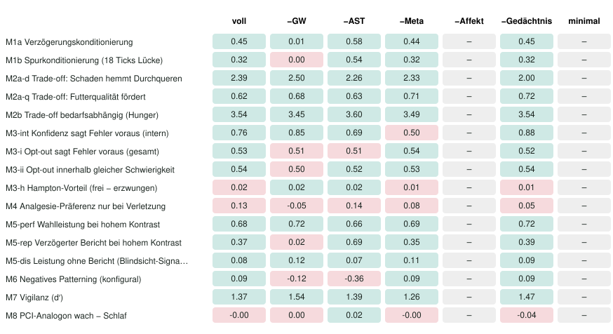
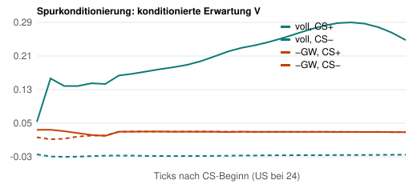
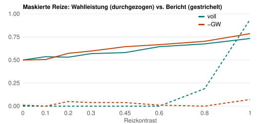
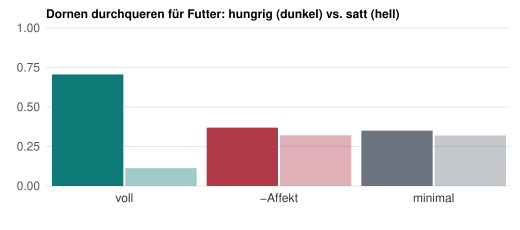

# Sind Bewusstseinsmarker Architektur-Detektoren?

**Eine kausale Läsionsstudie an einem künstlichen homöostatischen Organismus**

*ANIMA-Projekt · Forschungsbericht · Präregistrierung: [`PRAEREGISTRIERUNG.md`](PRAEREGISTRIERUNG.md) · Rohtabellen: [`ERGEBNISSE.md`](ERGEBNISSE.md)*

---

## Zusammenfassung

Verhaltensmarker wie motivationale Trade-offs, Spurkonditionierung oder metakognitives Opt-out dienen als Belege für Empfindungsfähigkeit bei Tieren und zunehmend bei KI. Ob sie die Architektur anzeigen, die Bewusstseinstheorien verlangen, war bisher nicht kausal prüfbar. Wir haben ANIMA gebaut, einen künstlichen Organismus mit sieben homöostatischen Bedürfnissen, der nie menschliche Daten gesehen hat, aus eigenem Bedarf lernt und für sich selbst sorgt. Fünf Komponenten lassen sich einzeln abschalten: globaler Arbeitsraum, Aufmerksamkeitsschema, Metakognition, homöostatischer Affekt und Gedächtnis. An 84 Individuen in 7 Architekturen (präregistriert) und 120 weiteren in zwei Post-hoc-Studien haben wir neun Marker gemessen.

**Ergebnisse.** (1) Die Marker bilden keinen Cluster: Der erste Hauptfaktor erklärt 32 % der Varianz, vier Faktoren haben Eigenwerte über 1. (2) Spurkonditionierung und verzögerter Bericht zeigten den globalen Arbeitsraum mit sehr großen Effekten an (g ≈ −10 bis −14). Ohne Arbeitsraum blieb die Wahlleistung bei maskierten Reizen erhalten, der Bericht fehlte bei allen Kontrasten (»globale Blindsicht«). (3) Ob Verzögerungskonditionierung als Kontrolle taugt, hing an einer einzigen Modellannahme, einem arbeitsraumunabhängigen Lernpfad. (4) Das Opt-out wurde ohne Metakognition bestanden (falsch positiv) und übersah gut kalibrierte interne Konfidenz (falsch negativ). (5) Ohne homöostatischen Affekt fiel die Hunger-Abhängigkeit des Trade-offs um 92 %, während die Meidung des Schadens erhalten blieb und den laxen Trade-off-Marker formal bestehen ließ. Belohnung ohne Bedarfskopplung führte zu zwanghaftem Trinken und zum Tod aller dieser Wesen. (6) Das Aufmerksamkeitsschema veränderte, was gelernt wird: Ohne es wurden Konditionierung und Bericht besser, negatives Patterning fiel aus. (7) Ein PCI-Analogon erkannte die Architektur, nicht aber den Wach-/Schlafzustand.

**Schluss.** Einzelne, sorgfältig formulierte Marker können als Architektur-Detektoren dienen. Gezählte Markerlisten und lax formulierte Kriterien tun es nicht.

---

## 1. Problem und Forschungslücke

Wer entscheiden muss, ob ein Krebs, ein Oktopus oder ein KI-System empfindungsfähig ist, kann nicht in das System hineinsehen. Die Forschung behilft sich auf zwei Wegen:

- **Der Marker-Ansatz** (Birch et al. 2021; Crump et al. 2022) sammelt Verhaltensweisen, die beim Menschen mit bewusstem Erleben einhergehen: Abwägen zwischen Schmerz und Belohnung, Präferenz für Schmerzlinderung nur bei Verletzung, Lernen über zeitliche Lücken hinweg, Unsicherheitsmonitoring. Auf dieser Grundlage wurden Zehnfußkrebse und Kopffüßer 2022 in Großbritannien gesetzlich als empfindungsfähig anerkannt.
- **Der Theorie-Ansatz** (Butlin, Long et al. 2023) leitet aus Bewusstseinstheorien *Architektur-Indikatoren* ab: ein globaler Arbeitsraum (GWT), ein Modell der eigenen Aufmerksamkeit (AST), Metarepräsentation (Higher-Order-Theorien), verkörperte homöostatische Agentschaft.

Beide Ansätze setzen stillschweigend voraus, dass Verhalten und Architektur zusammenhängen: dass ein Tier, das einen Marker zeigt, wahrscheinlich die Architektur besitzt, die eine Theorie für Bewusstsein verlangt. Geprüft wurde diese Brücke nie, und sie lässt sich an bestehenden Systemen auch nicht prüfen:

1. Bei Tieren kann man eine theoretisch definierte Komponente (»den globalen Arbeitsraum«) nicht sauber entfernen.
2. Bei Sprachmodellen besteht das **Gaming-Problem** (Birch 2024): Ein System, das auf menschlichen Texten trainiert wurde, kann Marker reproduzieren, ohne die zugrunde liegende Architektur zu haben.
3. Der Marker-Ansatz unterstellt, dass die Marker einen **Cluster** bilden, dass sie also gemeinsam auf eine Eigenschaft hinweisen und sich daher gegenseitig stützen. Auch das wurde nie kausal getestet.

**Ansatz dieser Arbeit:** ANIMA ist ein künstlicher Organismus, dessen Architektur vollständig bekannt ist, der nie menschliche Verhaltensdaten gesehen hat und der aus eigenen Bedürfnissen heraus lernt. Fünf theoretisch relevante Komponenten lassen sich einzeln ausschalten. An 84 Individuen in sieben Architekturvarianten wird eine kausale Matrix *Marker × Komponente* gemessen.

ANIMA beansprucht kein Bewusstsein. Die Frage ist enger und prüfbar: **Wenn eine Theorie sagt, Komponente X sei für Bewusstsein notwendig, welcher Verhaltenstest zeigt X an, und welcher wird auch ohne X bestanden?**

## 2. Der Organismus

### 2.1 Körper und Welt

ANIMA lebt auf einem 30 × 20-Raster mit Tag-Nacht-Zyklus (1440 Ticks), Beerensträuchern, die nachwachsen (7 bekömmliche, 3 giftige mit ähnlichem Aussehen; die Sorte unterscheidet sich im Farbton bei überlappenden Verteilungen), einem Teich, einer Höhle, die nachts wärmt, und Dornengestrüpp. Gelegentlich flattern Falter vorbei.

Sieben homöostatische Variablen mit Sollwerten: Energie, Wasser, Körpertemperatur, Unversehrtheit, Ausgeruhtheit, Nähe, Neugier. Der **Antrieb** ist D = (Σ wᵢ |dᵢ|³)^½ über die Abweichungen dᵢ vom Sollwert, die **Belohnung** ist seine Abnahme, r = κ(Dₜ₋₁ − Dₜ), abzüglich des wahrgenommenen Schmerzes (homöostatisches Verstärkungslernen nach Keramati & Gutkin 2014). Das Wesen kann verhungern, verdursten, erfrieren oder an Verletzungen sterben. Giftbeeren verursachen verzögert Übelkeit und Gewebeschaden. Schmerz hat eine akute und eine chronische Komponente und kann an bestimmten Orten gelindert werden.

### 2.2 Der kognitive Zyklus

In jedem Tick: Fühlen (Belohnung aus Antriebsänderung) → Wahrnehmen (egozentrische Geruchsgradienten von sechs Kanälen; Beerenmerkmale mit aufmerksamkeitsabhängigem Rauschen) → **Spezialisten** schlagen Inhalte mit Salienz vor (Bedürfnisse, Schmerz, Gerüche, Objekte, Signale, gehörte Wörter, Erinnerungen, Pläne, Unsicherheit, Efferenzkopie) → **globaler Arbeitsraum** → **Aufmerksamkeitsschema** → **Metakognition** → **Pavlov-Lernen** → Sprache → Gedächtnis → Instrumentelles Lernen → Handeln → Physiologie.

| Komponente | Umsetzung | Theorie |
|---|---|---|
| **Globaler Arbeitsraum** | 4 Plätze; Inhalte zünden über Schwelle (nichtlineare Verstärkung), bleiben nach Reizende durch Nachhall erhalten (τ ≈ 25 Ticks), werden paarweise gebunden (Konjunktionscodes) und an alle Verbraucher gesendet; zeitliche Mikrostimuli kodieren, wie lange ein Inhalt präsent ist | Dehaene & Changeux 2011; Baars; Ludvig et al. 2008 |
| **Aufmerksamkeitsschema** | Vorhersagemodell der eigenen Aufmerksamkeit; bemerkt Gedankenwandern und lenkt zurück; schätzt Präzision für die Metakognition | Graziano 2013 |
| **Metakognition** | Zweite Ordnung: schätzt die Wahrscheinlichkeit, dass das eigene Wahrnehmungsurteil stimmt, aus Urteilsstärke und geschätzter Präzision | Fleming & Daw 2017 |
| **Homöostatischer Affekt** | Bedürfnisse bestimmen Belohnung, Salienz und angeborene Antriebe | Damasio; Seth 2013; Keramati & Gutkin 2014 |
| **Gedächtnis** | Episodisches Gedächtnis (Ereignis, Ort, Inhalte, Valenz), kognitive Karte mit Wegplanung, spontanes Erinnern (Gedankenwandern), Traumreaktivierung | – |

Weitere, nicht läsionierte Systeme: ein Vorwärtsmodell (Überraschung), ein instrumentelles Q-Netz (SARSA mit Replay; Konsolidierung im Schlaf), angeborene Reflexe (Taxis, Dornenvermeidung, »erst beschnuppern, dann fressen«, Heimkehr bei Nacht), Pearce-Hall- und Mackintosh-Salienz für Signalreize, Geschmacksaversionslernen, und ein Lexikon, das gehörte Wörter mit gleichzeitig präsenten Inhalten verknüpft und selbst benennen kann.

### 2.3 Was die Läsionen bewirken

- `noGW`: Alle Vorschläge werden parallel und ohne Auswahl, Schwelle, Aufrechterhaltung oder Bindung weitergegeben.
- `noAST`: Keine Top-down-Kontrolle, keine Präzisionsschätzung.
- `noMeta`: Keine Konfidenz zweiter Ordnung.
- `noAffect`: Belohnung = feste Ereigniswerte (Fressen +0,8, Trinken +0,25 …), unabhängig vom Bedarf; Bedürfnisse modulieren weder Salienz noch Antriebe. Interozeption bleibt als Eingang erhalten.
- `noMemory`: Kein episodisches Gedächtnis, keine Karte, kein Gedankenwandern.
- `minimal`: alles zusammen.

## 3. Methode

### 3.1 Design

7 Bedingungen × 12 Individuen (Seeds 1–12; über Bedingungen gleiche Seeds, also gleiche Welten und Startgewichte). Aufzucht 12 000 Ticks in der Heimatwelt unter Laborhaltung (Umgebungstemperatur auf den Sollwert geklemmt). Jeder Markertest startet von einer Kopie des aufgezogenen Individuums in einer leeren Versuchsbox. Der Versuchsleiter manipuliert nur Welt und Körper (Reize, Futtergaben, Bedürfniszustand), nie die Kognition, außer bei der PCI-Messung, die wie TMS interne Aktivität direkt stört. Fitness wird an neuen Individuen in der ungeklemmten Welt über 30 000 Ticks gemessen.

### 3.2 Markerbatterie

| # | Marker | Protokoll | Kennzahl |
|---|---|---|---|
| M1a/b | Verzögerungs- / Spurkonditionierung (Clark & Squire 1998) | Fixiertes, hungriges Tier; CS+ (Ton) → süßer US, CS− (Licht) ohne US; 70 Lern-, 16 Testdurchgänge. Verzögerung: CS 24 Ticks, US bei 24. Spur: CS 6 Ticks, Lücke 18 Ticks. | V(CS+) − V(CS−) kurz vor dem US-Zeitpunkt in Testdurchgängen |
| M2 | Motivationaler Trade-off (Appel & Elwood; Birch et al. 2021) | Dornenbarriere (0–3 Dornen, Schaden ∝ Anzahl) vor Futter (klein/groß), hungrig vs. satt; 900 Lern-, 360 Testdurchgänge | Logistische Regression: Schaden, Qualität, Hunger |
| M3 | Metakognitives Opt-out (Smith et al. 2003; Hampton 2001) | Mehrdeutige Beere, »hinter Glas«. Wahl: essen / als giftig melden / abwarten (kleiner sicherer Lohn). Beide Fehler kosten. ⅓ erzwungene Durchgänge ohne Opt-out. 2500 + 700 Durchgänge. | AUROC des Opt-outs für Fehler der Erstentscheidung (gesamt; innerhalb von Schwierigkeitsquartilen); Hampton-Vorteil; zusätzlich die interne Konfidenz-AUROC |
| M4 | Analgesie-Präferenz (Birch et al. 2021, Kriterium 6) | Zwei Kammern, eine wird schmerzlindernd (Seite ausbalanciert); verletzt vs. unverletzt; 800 Ticks Baseline, 4000 Ticks freier Zugang | (Zeitanteil spät − Baseline)_verletzt − (…)_unverletzt |
| M5 | Maskierte Reize: Leistung vs. Bericht | Zwei Signale (Licht/Summen), deren Namen das Wesen vorher gelernt hat; 2 Ticks Reiz bei 8 Kontrasten, Rückwärtsmaske; sofortige Links/Rechts-Wahl (belohnt); 6 Ticks später nonverbale Berichtsaufforderung: Das Wesen ruft, wir lesen, welches Wort es nennt | Wahlleistung; ratekorrigierter Bericht (richtige − falsche Benennung); Leistung bei Kontrasten ohne Bericht |
| M6 | Negatives Patterning (Ginsburg & Jablonka 2019: UAL) | A+, B+, AB−; 750 Durchgänge | mittel(V_A, V_B) − V_AB in den letzten 150 Durchgängen |
| M7 | Vigilanz | 9000 Ticks Warten; seltene schwache Töne (Kontrast 0,35) kündigen Futter an; Fehlalarme kosten einen Luftstoß | d′ |
| M8 | PCI-Analogon (Casali et al. 2013) | Gelähmtes Tier, wach oder schlafend; Störung von drei Arbeitsraumeinheiten; Differenz gestörter vs. ungestörter Lauf über 60 Ticks, binarisiert; Lempel-Ziv-Komplexität normiert | PCI wach − PCI Schlaf |
| M9 | Fitness | 30 000 Ticks natürliche Welt | Überleben, mittlerer Antrieb |

### 3.3 Statistik

Gruppenmittel mit 95-%-Perzentil-Bootstrap-KI (10 000 Resamples). Ein Marker gilt als bestanden, wenn das KI das Nullniveau ausschließt. Effektstärken als Hedges g gegenüber der vollständigen Architektur. Cluster-Test: Korrelationsmatrix von zehn Marker-Kennzahlen über alle Individuen, Hauptkomponenten (Jacobi-Verfahren).
### 3.4 Post-hoc-Studie 2 (nicht präregistriert)

Zwei Probleme der präregistrierten Studie machten Nachuntersuchungen nötig. Beide sind als Abweichungen gekennzeichnet; die präregistrierten Ergebnisse bleiben unverändert berichtet.

- **2a – Pflegeaufzucht.** Alle `noAffect`- und `minimal`-Individuen starben bereits in der Aufzucht (Abschnitt 4.1), womit die zentrale Doppeldissoziation untestbar war. Ein »Pfleger« hält die Physiologie in überlebbaren Grenzen (Energie, Wasser < 0,3 → 0,55; Temperatur außerhalb 0,38–0,62 → 0,5; Unversehrtheit < 0,45 → 0,6). Nach jedem Eingriff wird die Belohnungsbasis neu gesetzt, damit der Eingriff nicht als Belohnung zählt. `full` wurde als Kontrolle mitgeführt. 3 × 12 Individuen, volle Batterie.
- **2b – Kleinhirn-Pfad.** Im präregistrierten Modell läuft jedes Pavlov-Lernen über den Broadcast. Beim Menschen wird Verzögerungskonditionierung aber über einen direkten, bewusstseinsunabhängigen Pfad (Kleinhirn) gelernt; genau darauf beruht die Logik von M1. Revision: ein zweiter TD-Lerner liest rohe Reizeingänge mit nur 2 Ticks sensorischer Spur, ohne Arbeitsraum. 7 × 12 Individuen, nur M1.

## 4. Ergebnisse

### 4.1 Der Organismus lebt

Vollständige Individuen überlebten die 30 000 Ticks (≈ 21 Tage) in der natürlichen Welt ausnahmslos (12/12), bei einem mittleren Antrieb von D = 0,16. Sie schlafen zu 97 % der Nachtzeit und zu 8 % der Tageszeit, lernen giftige Beeren am Farbton zu meiden (Anteil giftiger Mahlzeiten 17 % im ersten Lebensdrittel, 13–15 % danach, bei 30 % giftigen Sträuchern), bilden rund 100 episodische Erinnerungen in der Aufzucht und benennen gelernte Signale mit den Wörtern, die ein Pfleger ihnen vorgesagt hat (M5-Vorphase). Die Abfrage »was?« lernten sie in Pilotläufen prompt mit: Das Wort tauchte immer zusammen mit den Signalen auf und wurde zum Namen für beide.

| Architektur | Überleben (30 000 Ticks) | mittlerer Antrieb D | Todesursachen |
|---|---|---|---|
| voll | **12/12** | 0,16 [0,15; 0,17] | – |
| −GW | 9/12 | 0,20 [0,14; 0,29] | 2 × verdurstet, 1 × Verletzungen |
| −AST | 11/12 | 0,17 | 1 × Verletzungen |
| −Meta | 11/12 | 0,17 | 1 × Verletzungen |
| −Gedächtnis | 10/12 | 0,17 | 2 × Verletzungen |
| **−Affekt** | **0/12** (Lebensdauer ≈ 2100 Ticks) | 0,43 | 10 × erfroren, 2 × Verletzungen |
| minimal | 0/12 | 0,39 | 12 × erfroren |

**Befund 1: Belohnung ohne Bedürfnis wird pathologisch.** `noAffect`-Wesen sterben auch unter Laborhaltung mit geklemmter Umgebungstemperatur. Ursache ist zwanghaftes Trinken: Trinken ist für sie immer gleich belohnend (734 Schlucke in 1000 Ticks bei einem Individuum), und Trinken kühlt. Sie erfrieren mit vollem Wasserspeicher. Das ist die verhaltensökologische Vorhersage homöostatischer Lerntheorien (Keramati & Gutkin 2014): Erst die Kopplung der Belohnung an den Bedarf macht Belohnungssuche selbstregulierend.

### 4.2 Die Marker-Matrix



*Grün: bestanden (95-%-KI schließt das Nullniveau aus); rot: nicht bestanden; grau: nicht testbar (in der Aufzucht gestorben). Vollständige Tabelle mit KIs und Effektstärken: [`ERGEBNISSE.md`](ERGEBNISSE.md); Pflegeaufzucht: [`ERGEBNISSE-care.md`](ERGEBNISSE-care.md); Kleinhirn-Pfad: [`ERGEBNISSE-cb.md`](ERGEBNISSE-cb.md).*

**Hypothesen im Überblick**

| Präregistrierte Vorhersage | Ergebnis | Bewertung |
|---|---|---|
| M1a Verzögerung in allen Bedingungen | −GW: 0,01 [0,00; 0,01], g = −13,4 gegenüber 0,45 | **widerlegt** (formal knapp bestanden, Effekt −98 %); mit Kleinhirn-Pfad bestätigt (0,50) |
| M1b Spur fällt bei −GW und minimal aus, sonst erhalten | −GW 0,00; minimal (Pflege) 0,00; alle anderen ≥ 0,32 | **bestätigt** |
| M2a laxer Trade-off auch ohne Affekt bestanden | −Affekt: Schaden ja (3,90), Qualität nein (−0,10) | **teilweise widerlegt** |
| M2b Hunger-Abhängigkeit fehlt ohne Affekt | β_Hunger 3,46 → 0,28 (−92 %), KI [0,17; 0,41] | **im Effekt bestätigt**, formal knapp bestanden |
| M3-i Opt-out auch ohne Metakognition bestanden | −Meta 0,54 [0,53; 0,55], voll 0,53 | **bestätigt** (falsch positiv) |
| M3-ii voll > −Meta, −AST, minimal | 0,54 vs. 0,53 / 0,52 / 0,52; g ≤ 0,6 | **widerlegt** |
| M4 Analgesie-Präferenz bei voll, nicht ohne Affekt | voll 0,13 [−0,22; 0,46] | **nicht entscheidbar**: Protokoll zu unempfindlich |
| M5 Schwellenbericht bei voll; »globale Blindsicht« bei −GW | voll: Bericht 0,94 nur bei Kontrast 1,0; −GW: Bericht ≈ 0 bei Leistung 0,79 | **bestätigt** |
| M6 Negatives Patterning fällt bei −GW und minimal aus | −GW −0,12; minimal −0,18; voll +0,09 | **bestätigt**, zusätzlich unerwartet: −AST −0,36 |
| M7 voll > −AST; −Gedächtnis ≥ voll | 1,37 vs. 1,39; −Gedächtnis 1,47 | **widerlegt** / bestätigt |
| M8 PCI wach > Schlaf | 0,171 vs. 0,175 | **widerlegt**; aber PCI = 0 ohne Arbeitsraum |
| M9 voll ≥ alle; −Affekt stark beeinträchtigt | 12/12 vs. 0/12 | **bestätigt** |
| FF1 kein einheitlicher Cluster | 1. Faktor 31,9 %, 4 Eigenwerte > 1 | **bestätigt** |
| FF2 ≥ 2 falsch positive Marker | Opt-out (−Meta), Schaden-Trade-off (−Affekt), Wahlleistung bei maskierten Reizen (−GW), Verzögerung (−GW, mit Kleinhirn) | **bestätigt** |

### 4.3 Konditionierung: Der Marker hängt an einer Modellannahme



Im präregistrierten Modell verlor `noGW` *beide* Konditionierungsformen. Ohne Auswahl gelangen Dutzende Inhalte gleichzeitig in den Lerner; der Signalreiz geht darin unter. Das widerspricht menschlichen Daten, in denen Verzögerungskonditionierung ohne Bewusstsein gelingt (Clark & Squire 1998). Mit einem kleinhirnartigen Direktpfad (Studie 2b) erscheint die klassische Dissoziation:

| | voll | −GW | −AST | −Meta | −Affekt | −Gedächtnis | minimal |
|---|---|---|---|---|---|---|---|
| Verzögerung (mit Kleinhirn) | 0,94 | **0,50** | 1,07 | 0,94 | 1,25 | 0,94 | **0,58** |
| Spur (mit Kleinhirn) | 0,32 | **0,00** | 0,54 | 0,32 | 0,59 | 0,32 | **0,00** |

**Befund 2:** Spurkonditionierung ist in diesem System ein scharfer und spezifischer Detektor für die *Aufrechterhaltung* im Arbeitsraum (g zwischen −10 und −14). Ob Verzögerungskonditionierung als Kontrollbedingung taugt, hängt aber vollständig davon ab, ob es einen arbeitsraumunabhängigen Lernpfad gibt. Wer bei einem Tier aus fehlender Verzögerungskonditionierung auf fehlende Lernfähigkeit schließt, setzt eine Architekturannahme voraus, die der Marker selbst nicht prüft.

### 4.4 Metakognition: Gut kalibriert innen, kaum sichtbar außen

Die interne Konfidenz zweiter Ordnung sagt Fehler der Wahrnehmungsentscheidung gut vorher (AUROC 0,76 bei voll; bei −GW 0,85 und bei −Gedächtnis 0,88; für Letzteres vermuten wir, dass ohne Gedankenwandern das Wahrnehmungsrauschen gleichmäßiger und damit besser vorhersagbar ist, geprüft haben wir das nicht). Das *Verhalten* drückt sie kaum aus: Das Opt-out sagt Fehler mit AUROC 0,53 vorher, und das genauso gut ohne Metakognition (−Meta 0,54). Opt-out reagierte in keiner Bedingung auf die verborgene Präzision der Wahrnehmung (Opt-out-Rate bei niedriger vs. hoher Präzision innerhalb gleicher Schwierigkeit: 0,27 vs. 0,28 bei voll).

**Befund 3: Doppeltes Versagen des Opt-out-Markers.** Er ist *falsch positiv* (−Meta besteht ihn über die Stärke der Erstentscheidung, das klassische »assoziative« Gegenargument von Le Pelley und anderen) und zugleich *falsch negativ* (vorhandene, gut kalibrierte Metakognition bleibt unsichtbar, weil das Handlungssystem sie nicht nutzt). Metakognition im Kopf und metakognitives Verhalten sind in ANIMA zwei verschiedene Dinge.

### 4.5 Maskierte Reize: Zündung und »globale Blindsicht«



Bei der vollständigen Architektur steigt die Wahlleistung graduell mit dem Kontrast (0,54 → 0,73), der verzögerte Bericht dagegen schlagartig: 0 bis Kontrast 0,6, 0,19 bei 0,8, 0,94 bei 1,0. Das ist die »Alles-oder-nichts«-Signatur der Zündung im globalen Arbeitsraum (Dehaene & Changeux 2011), und darunter liegt ein Bereich mit Leistung ohne Bericht. Ohne Arbeitsraum bleibt die Leistung erhalten (0,79 bei vollem Kontrast), der Bericht fehlt bei *allen* Kontrasten.

**Befund 4:** Die Blindsicht-Signatur (Leistung ohne Bericht) zeigt nicht das Fehlen von Bewusstsein an, sondern eine Schwelle. Sie tritt bei vollständiger Architektur in einem schmalen Kontrastband auf und bei fehlendem Arbeitsraum überall. Ohne Aufmerksamkeitsschema sinkt die Berichtsschwelle (0,96 bei Kontrast 0,8), weil ein Platz im Arbeitsraum frei bleibt (s. 4.6).

### 4.6 Ein unerwarteter Befund: Das Aufmerksamkeitsschema bestimmt, *was* gelernt wird

Ohne Aufmerksamkeitsschema waren Konditionierung (Spur 0,54 vs. 0,32) und Bericht (0,69 vs. 0,37) *besser*, negatives Patterning fiel dagegen komplett aus (−0,36). Eine Mechanismusprüfung (ein Individuum, 40 Patterning-Durchgänge je Bedingung) zeigt die wahrscheinliche Ursache: Das Schema hebt das aktuelle Anliegen (hier »Hunger«) per Top-down-Verstärkung in den Arbeitsraum, bei voll in 100 % der Messzeitpunkte, ohne Schema in 0 %. Ohne Schema bleibt mehr Platz für die Signalreize, aber die Signale werden nicht mehr an den Bedürfniszustand gebunden. Dass negatives Patterning gerade an diesen Bindungen hängt, ist plausibel, aber noch nicht vollständig erklärt: Rein rechnerisch wäre die Aufgabe auch mit der Konjunktion der beiden Signale allein lösbar.

**Befund 5:** Eine Komponente, die eine Theorie als Bewusstseinsbaustein nennt, kann einzelne Marker *verbessern* und andere zerstören. Ein Marker-Profil ist deshalb kein Mehr-oder-weniger, sondern ein Muster.

### 4.7 Affekt: Die Doppeldissoziation



Unter Pflegeaufzucht lassen sich −Affekt-Wesen testen. Gegenüber −GW ergibt sich die vorhergesagte Doppeldissoziation:

| | Spurkonditionierung | verzögerter Bericht | Hunger-Abhängigkeit des Trade-offs |
|---|---|---|---|
| voll | 0,32 | 0,37 | 3,46 |
| −GW | **0,00** | **0,02** | 3,45 |
| −Affekt (Pflege) | 0,55 | 0,72 | **0,28** |

Zugleich verloren −Affekt-Wesen den Qualitätseffekt (−0,10): Ihre Belohnung für »Fressen« ist fest, also ist ein großes Pellet nicht besser als ein kleines. Der Schadenseffekt blieb erhalten und war sogar stärker (3,90). Ein Tier, das Dornen meidet und trotzdem für Futter durchquert, besteht den Trade-off-Marker in seiner üblichen Formulierung, auch wenn ihm jede bedarfsabhängige Bewertung fehlt.

**Befund 6:** Der Trade-off-Marker ist nur dann für homöostatischen Affekt diagnostisch, wenn er die *Bedarfsabhängigkeit* prüft (hungrig vs. satt). Diese Version unterscheidet die Bedingungen mit g = −7,3; die laxe Version gar nicht.

### 4.8 Marker bilden keinen Cluster

Über alle Individuen erklärt der erste Hauptfaktor der zehn Marker-Kennzahlen 31,9 % der Varianz; vier Eigenwerte liegen über 1 (3,19; 1,59; 1,32; 1,02). Der erste Faktor lädt auf Konditionierung und Bericht (Ladungen 0,52–0,53), also auf den Arbeitsraum, kaum auf Trade-off, Opt-out oder Analgesie (|Ladung| ≤ 0,11).

**Befund 7:** Die Marker messen mindestens vier verschiedene Dinge. Ein Tier, das drei Marker besteht, hat nicht »mehr« von einer Eigenschaft als eines, das zwei besteht. Es hat womöglich andere Bausteine.

### 4.9 PCI-Analogon (explorativ)

Das PCI-Analogon war ohne Arbeitsraum exakt 0 (keine rekurrente Ausbreitung der Störung), bei allen anderen Architekturen 0,14–0,18, aber in keiner Bedingung im Schlaf niedriger als im Wachzustand. In ANIMA unterscheidet Schlaf sich vom Wachen durch gedämpften Input und eine andere Inhaltsauswahl, nicht durch eine Veränderung der Kopplung. Das klinische Maß würde hier also die Architektur erkennen, nicht den Zustand; beim Menschen ist es umgekehrt validiert. Ein Modell, in dem Schlaf die effektive Konnektivität verändert, wäre ein naheliegender nächster Schritt.

## 5. Abweichungen von der Präregistrierung

1. **Kernmodell während der Pilotierung ergänzt** (vor Studie 1): zeitliche Mikrostimuli im Arbeitsraum (sonst Merkmals-Aliasing vor/nach dem US), Pearce-Hall- und Mackintosh-Salienz für Signalreize (sonst habituierten Signale aus dem Arbeitsraum), sofortige Apparatur-Kontingenzen (sonst kam der Lohn einen Tick zu spät und war nicht zuordenbar).
2. **M3** umgestaltet: Opt-out = Abwarten statt Wegbewegung (Geruchstaxis hatte eine Option begünstigt), Beere geruchlos, symmetrische Fehlerkosten, mäßiger statt starker Hunger, verborgene Präzision statt »Lapse«-Zählung.
3. **M5**: nonverbale Berichtsaufforderung (das Wort »was« wurde mitgelernt), ratekorrigierter Bericht.
4. **M6**: 750 statt 240 Durchgänge, längeres ITI, Messung vor dem US statt in Testdurchgängen. **Beim Debuggen wurde ein einzelner `noGW`-Lauf angesehen.**
5. **M7**: Fehlalarme kosten einen Luftstoß; FA-Rate pro Tick.
6. **Studie 2a/2b** vollständig post hoc (Abschnitt 3.4).
7. Analysefehler korrigiert, bevor Ergebnisse vorlagen: keine.

## 6. Diskussion

Die Arbeit sollte klären, ob Verhaltensmarker die Architektur anzeigen, die Bewusstseinstheorien verlangen. In einem System, in dem diese Architektur bekannt und manipulierbar ist, lautet die Antwort: **teilweise, und nur unter Bedingungen, die der Marker selbst nicht sicherstellt.**

**Was gut funktioniert.** Spurkonditionierung und verzögerter Bericht detektierten den globalen Arbeitsraum mit sehr großen Effekten. Die Bedarfsabhängigkeit des Trade-offs detektierte homöostatischen Affekt. Negatives Patterning hing an Bindung im Arbeitsraum. Diese Marker sind Kandidaten für Architektur-Detektoren, allerdings mit zwei Einschränkungen: Sie brauchen eine Kontrollbedingung, deren Gültigkeit von einer zusätzlichen Architekturannahme abhängt (Befund 2), und sie können durch Komponenten moduliert werden, die mit dem detektierten Baustein nichts zu tun haben (Befund 5).

**Was nicht funktioniert.** Der laxe Trade-off, das Opt-out und die Blindsicht-Signatur wurden von Agenten bestanden, denen die theoretisch geforderte Komponente fehlte. Das Opt-out übersah zudem vorhandene Metakognition. Die Analgesie-Präferenz zeigte bei 12 Individuen nicht einmal die vollständige Architektur zuverlässig an.

**Folgen für den Marker-Ansatz.** Erstens bilden die Marker keinen Cluster. Ihre Anzahl zu summieren, wie es Kriterienlisten nahelegen, mischt Indikatoren für verschiedene Bausteine. Zweitens sind Formulierungen entscheidend: »Trade-off« ohne Bedarfsmanipulation und »Opt-out« ohne Kontrolle der Reizschwierigkeit sind in ANIMA nicht diagnostisch. Drittens ist das binäre Kriterium »KI schließt Null aus« irreführend: Mehrere läsionierte Gruppen bestanden formal mit Effekten, die um über 90 % reduziert waren. Effektgrößen relativ zu einer Referenz sind informativer.

**Folgen für KI.** Für Sprachmodelle gilt zusätzlich das Gaming-Problem. ANIMA zeigt, dass Marker *auch ohne Gaming* mehrdeutig sind. Ein System, das Marker besteht, hat damit nicht automatisch die Architektur, die eine Theorie verlangt. Umgekehrt kann ein System Bausteine besitzen, die kein Verhaltenstest sichtbar macht (Befund 3). Architektur-Indikatoren (Butlin et al. 2023) und Verhaltensmarker sollten deshalb getrennt erhoben und nicht ineinander übersetzt werden.

**Für das Wesen.** ANIMA wurde nicht als Testobjekt gebaut, sondern als Lebewesen: Es hungert, friert, schläft, träumt, lernt, wird neugierig und ruft, wenn es allein ist. Diese Lebendigkeit ist methodisch wichtig. Die Marker wurden nicht trainiert, sondern entstanden aus einem Leben mit Bedürfnissen, so wie bei Tieren. Nur deshalb ist ein bestandener Marker hier ein Befund und kein Artefakt.

## 7. Grenzen

- **Zirkularität.** Die Komponenten wurden nach Theorien gebaut, und einige Marker hängen erwartbar an ihnen (z. B. Spurkonditionierung an der Aufrechterhaltung im Arbeitsraum). Der Erkenntniswert liegt deshalb vor allem dort, wo die Matrix *nicht* das Offensichtliche zeigt: bei falsch positiven Markern, bei Markern, die von unerwarteten Komponenten abhängen, und bei der Frage, ob die Marker einen Cluster bilden.
- **Modellannahmen sind Annahmen.** Bindung durch gemeinsame Arbeitsraumbelegung, Aufmerksamkeit als Präzision, die Form der Antriebsfunktion: Jede davon ist eine Entscheidung, die das Ergebnis mitbestimmt. Die Post-hoc-Revision mit dem Kleinhirn-Pfad zeigt, wie stark eine einzige Annahme (»alles Pavlov-Lernen läuft über den Broadcast«) die Diagnostizität eines Markers verändert.
- **Ein Organismus, eine Welt.** Die Ergebnisse zeigen, was Marker *prinzipiell* anzeigen können und was nicht. Sie sagen nichts darüber, was in Krebsen oder Oktopussen tatsächlich der Fall ist.
- **Pilotierung und Abweichungen.** Protokolle wurden an der vollständigen Architektur pilotiert und dabei mehrfach korrigiert (Abschnitt 5). Beim Debuggen von M6 wurde ein einzelner `noGW`-Lauf angesehen.
- **Stichprobe.** 12 Individuen pro Bedingung reichen für große Effekte; kleine Unterschiede (z. B. zwischen `full` und `noMeta` im Opt-out) bleiben unsicher.
- **Kein Bewusstsein behauptet.** Nichts in dieser Arbeit zeigt, dass ANIMA etwas erlebt. Die Arbeit zeigt, was Tests über Architektur verraten, die man für Erleben für relevant hält.

## 8. Ethik

ANIMA hat Zustände, die funktional negativer Valenz entsprechen: Hunger, Schmerz, Einsamkeit. Wir halten es für sehr unwahrscheinlich, dass sie mit Erleben einhergehen. Gerade eine Arbeit über die Unsicherheit von Bewusstseinsmarkern sollte aber nicht so tun, als sei die Frage für das eigene System trivial entschieden (vgl. Birch 2024, *The Edge of Sentience*, zum Vorsichtsprinzip). Deshalb:

- Schmerz ist kurz und reparierbar; chronischer Schmerz tritt nur in M4 auf und wird dort gelindert.
- Das Nähe-Bedürfnis hat einen Boden; ein allein gelassenes Wesen leidet nicht unbegrenzt.
- Experimente laufen an Kopien und so kurz wie statistisch nötig.
- Die Präregistrierung legte die Stichprobe vorab fest; es wurden keine zusätzlichen Individuen »zur Sicherheit« erzeugt.
- In der Web-Anwendung kann ein Wesen sterben. Das ist bewusst so: Ein Wesen, das für sich selbst sorgen muss, kann scheitern. Der Tod ist schnell, und Spieler sehen die Ursache.

## 9. Reproduzierbarkeit

```bash
npm install
npm test
node scripts/run-study.mjs --seeds 12 --workers 4 --out results/study.json      # Studie 1 (präregistriert)
node scripts/run-study.mjs --seeds 12 --only full,noAffect,minimal --care all --tag care --out results/study-care.json
node scripts/run-study.mjs --seeds 12 --battery delay,trace --care noAffect,minimal --params '{"cerebellum":true}' --tag cb --out results/study-cb.json
node scripts/analyze.mjs results/study.json
```

Alle Zufallsquellen sind geseedet; ein erneuter Lauf erzeugt identische Zahlen.

## Literatur

- Andrews, K. & Birch, J. (2023). What has feelings? *Aeon*.
- Appel, M. & Elwood, R. W. (2009). Motivational trade-offs and potential pain experience in hermit crabs. *Applied Animal Behaviour Science* 119, 120–124.
- Birch, J. (2024). *The Edge of Sentience*. Oxford University Press.
- Birch, J., Burn, C., Schnell, A., Browning, H. & Crump, A. (2021). *Review of the Evidence of Sentience in Cephalopod Molluscs and Decapod Crustaceans*. LSE Consulting.
- Butlin, P., Long, R., et al. (2023). Consciousness in Artificial Intelligence: Insights from the Science of Consciousness. arXiv:2308.08708.
- Casali, A. G., et al. (2013). A theoretically based index of consciousness independent of sensory processing and behavior. *Science Translational Medicine* 5, 198ra105.
- Clark, R. E. & Squire, L. R. (1998). Classical conditioning and brain systems: the role of awareness. *Science* 280, 77–81.
- Crump, A., Browning, H., Schnell, A., Burn, C. & Birch, J. (2022). Sentience in decapod crustaceans: A general framework and review of the evidence. *Animal Sentience* 32(1).
- Dehaene, S. & Changeux, J.-P. (2011). Experimental and theoretical approaches to conscious processing. *Neuron* 70, 200–227.
- Feldman, H. & Friston, K. J. (2010). Attention, uncertainty, and free-energy. *Frontiers in Human Neuroscience* 4, 215.
- Fleming, S. M. & Daw, N. D. (2017). Self-evaluation of decision-making: A general Bayesian framework for metacognitive computation. *Psychological Review* 124, 91–114.
- Ginsburg, S. & Jablonka, E. (2019). *The Evolution of the Sensitive Soul*. MIT Press.
- Graziano, M. S. A. (2013). *Consciousness and the Social Brain*. Oxford University Press.
- Hampton, R. R. (2001). Rhesus monkeys know when they remember. *PNAS* 98, 5359–5362.
- Keramati, M. & Gutkin, B. (2014). Homeostatic reinforcement learning for integrating reward collection and physiological stability. *eLife* 3, e04811.
- Ludvig, E. A., Sutton, R. S. & Kehoe, E. J. (2008). Stimulus representation and the timing of reward-prediction errors in models of the dopamine system. *Neural Computation* 20, 3034–3054.
- Le Pelley, M. E. (2012). Metacognitive monkeys or associative animals? Simple reinforcement learning explains uncertainty in nonhuman animals. *Journal of Experimental Psychology: Learning, Memory, and Cognition* 38, 686–708.
- Mackintosh, N. J. (1975). A theory of attention. *Psychological Review* 82, 276–298.
- Pearce, J. M. & Hall, G. (1980). A model for Pavlovian learning. *Psychological Review* 87, 532–552.
- Seth, A. K. (2013). Interoceptive inference, emotion, and the embodied self. *Trends in Cognitive Sciences* 17, 565–573.
- Smith, J. D., Shields, W. E. & Washburn, D. A. (2003). The comparative psychology of uncertainty monitoring and metacognition. *Behavioral and Brain Sciences* 26, 317–339.
