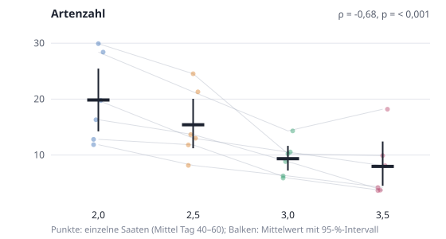
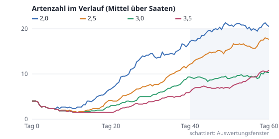

# Kontrollversuch: Wie stark hängt die Artenzahl von der Artdefinition ab?

**Hypothese.** Die Artschwelle ist eine reine Beobachtungsgröße. Sie verändert die Dynamik nicht, die genetische und die evolvierte Vielfalt müssen also auf allen Stufen exakt gleich sein, während die gezählte Artenzahl mit der Schwelle fällt.

Dieser Versuch prüft die Messung, nicht die Ökologie. Er zeigt, warum die Hauptversuche die genetische Vielfalt als primäre Messgröße verwenden und die Artenzahl nur ergänzend.

## Versuchsaufbau

| | |
| --- | --- |
| Faktor | `speciation` mit den Stufen 2,0 (`2`), 2,5 (`2.5`), 3,0 (`3`), 3,5 (`3.5`) |
| Wiederholungen | 6 Saaten (4000 bis 4005), jede auf jeder Stufe (gepaart) |
| Dauer | 60 Tage, gemessen wird der Mittelwert über Tag 40 bis 60 |
| Weitere Einstellungen | `immigrationUntil` = 10 |
| Primäre Messgröße | Artenzahl (vorab festgelegt), alle übrigen explorativ |
| Code-Stand | `6046d10`, Node v22.23.5, Rechenzeit 163 s |

## Ergebnisse

Mittelwerte mit 95-%-Bootstrap-Intervall. ρ ist Spearmans Rangkorrelation zwischen Stufe und Messwert; ihr p-Wert stammt aus einer Permutation der Stufen innerhalb jeder Saat. Der Höckertest vergleicht je Saat die inneren Stufen mit den beiden äußeren. Die p-Werte sind zusätzlich nach Holm über alle Messgrößen korrigiert.

| Messgröße | 2,0 | 2,5 | 3,0 | 3,5 | ρ | p | p (Holm) |
| --- | --- | --- | --- | --- | --- | --- | --- |
| **Artenzahl** | 19,85 [14,23; 25,47] | 15,41 [11,20; 20,06] | 9,34 [7,21; 11,64] | 7,96 [4,50; 12,41] | -0,68 | < 0,001 | < 0,001 |
| effektive Arten | 10,13 [7,03; 13,47] | 6,65 [5,09; 8,57] | 4,32 [3,15; 5,58] | 4,00 [2,27; 6,52] | -0,66 | < 0,001 | < 0,001 |
| evolvierte Vielfalt | 2,84 [2,50; 3,23] | 2,84 [2,51; 3,24] | 2,84 [2,51; 3,24] | 2,84 [2,51; 3,24] | 0,00 | 1,000 | 1,000 |
| genetische Vielfalt | 3,28 [2,75; 3,91] | 3,28 [2,77; 3,85] | 3,28 [2,75; 3,91] | 3,28 [2,77; 3,91] | 0,00 | 1,000 | 1,000 |
| Tiere | 568,96 [435,62; 703,07] | 568,96 [429,64; 700,98] | 568,96 [428,93; 702,92] | 568,96 [432,16; 699,04] | 0,00 | 1,000 | 1,000 |

## Dateien

- `runs.csv`: ein Lauf pro Zeile, mit den Fenster-Mittelwerten aller Messgrößen
- `timeseries.csv`: alle Messungen aller Läufe (alle halbe Tage)
- `manifest.json`: vollständige Parameter je Stufe, Saaten, Code-Stand
- `<messgröße>.svg`: Einzelwerte je Saat, Mittelwert und 95-%-Intervall

Neu erzeugen: `node tools/experiment.mjs experiments/artschwelle.json`
