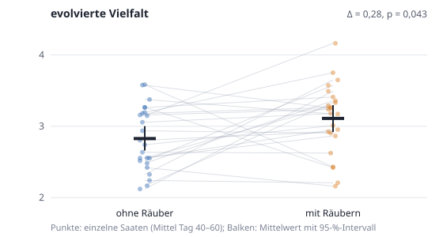
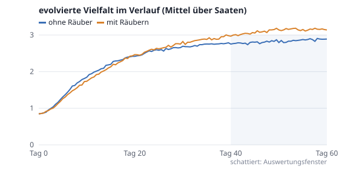

# Replikation: Erhöhen Räuber die Vielfalt?

**Hypothese.** Wenn Angriffe möglich sind, ist die evolvierte Vielfalt (Erbgut-Abstände innerhalb einer Gründerlinie) der Gemeinschaft höher als ohne Angriffe (Schlüsselräuber-Hypothese nach Paine 1966: Räuber halten dominante Konkurrenten kurz und schaffen so Platz für andere).

Der Faktor schaltet nur die Wirkung des Angriffsausgangs ab. Gehirne, Kosten und alles andere bleiben gleich. Nach Tag 10 wandert niemand mehr ein; die Gemeinschaft entwickelt sich danach als geschlossenes System. Dies ist eine unabhängige Wiederholung des Versuchs „praedation“ mit 24 neuen Saaten. Umfang und Auswertung standen fest, bevor sie lief; der erste Versuch hatte mit 12 Saaten p = 0,056 ergeben.

## Versuchsaufbau

| | |
| --- | --- |
| Faktor | `predation` mit den Stufen ohne Räuber (`false`), mit Räubern (`true`) |
| Wiederholungen | 24 Saaten (5000 bis 5023), jede auf jeder Stufe (gepaart) |
| Dauer | 60 Tage, gemessen wird der Mittelwert über Tag 40 bis 60 |
| Weitere Einstellungen | `immigrationUntil` = 10 |
| Primäre Messgröße | evolvierte Vielfalt (vorab festgelegt), alle übrigen explorativ |
| Code-Stand | `6046d10`, Node v22.23.5, Rechenzeit 434 s |

## Ergebnisse

Mittelwerte mit 95-%-Bootstrap-Intervall. Δ ist die mittlere gepaarte Differenz (zweite minus erste Stufe), getestet mit einem exakten Vorzeichen-Permutationstest; d_z ist die Effektstärke der Differenzen. Die p-Werte sind zusätzlich nach Holm über alle Messgrößen korrigiert.

| Messgröße | ohne Räuber | mit Räubern | Δ [95 %] | d_z | p | p (Holm) |
| --- | --- | --- | --- | --- | --- | --- |
| **evolvierte Vielfalt** | 2,83 [2,66; 3,00] | 3,11 [2,92; 3,30] | 0,28 [0,04; 0,53] | 0,44 | 0,043 | 0,142 |
| genetische Vielfalt | 2,86 [2,69; 3,03] | 3,17 [2,96; 3,38] | 0,31 [0,05; 0,58] | 0,46 | 0,036 | 0,142 |
| Gründerlinien | 1,18 [1,06; 1,32] | 1,08 [1,01; 1,18] | -0,09 [-0,23; 0,02] | -0,30 | 0,170 | 0,213 |
| Artenzahl | 19,97 [17,12; 23,39] | 15,13 [12,90; 17,40] | -4,84 [-8,49; -1,64] | -0,55 | 0,007 | 0,033 |
| effektive Arten | 8,87 [7,32; 10,68] | 7,17 [6,15; 8,23] | -1,70 [-3,71; 0,13] | -0,34 | 0,106 | 0,213 |
| Tiere | 854,98 [754,48; 948,85] | 537,09 [452,28; 624,89] | -317,89 [-430,18; -207,16] | -1,09 | < 0,001 | 0,001 |
| Größe ⌀ | 3,68 [3,49; 3,91] | 4,49 [4,16; 4,84] | 0,81 [0,44; 1,19] | 0,83 | 0,001 | 0,006 |
| Algen ⌀ | 0,32 [0,31; 0,34] | 0,38 [0,36; 0,40] | 0,06 [0,04; 0,08] | 0,99 | < 0,001 | 0,001 |

## Dateien

- `runs.csv`: ein Lauf pro Zeile, mit den Fenster-Mittelwerten aller Messgrößen
- `timeseries.csv`: alle Messungen aller Läufe (alle halbe Tage)
- `manifest.json`: vollständige Parameter je Stufe, Saaten, Code-Stand
- `<messgröße>.svg`: Einzelwerte je Saat, Mittelwert und 95-%-Intervall

Neu erzeugen: `node tools/experiment.mjs experiments/praedation-replikation.json`
