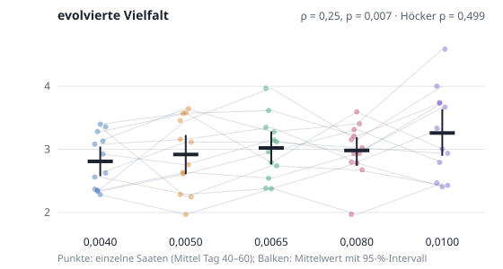
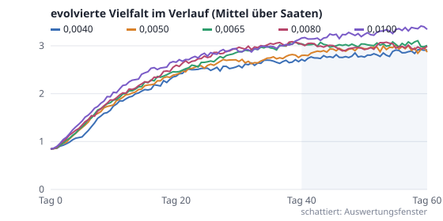

# Wie hängt die Vielfalt von der Produktivität ab?

**Hypothese.** Die evolvierte Vielfalt (Erbgut-Abstände innerhalb einer Gründerlinie) ist bei mittlerer Produktivität am höchsten (in vielen Ökosystemen beobachtete höckerförmige Beziehung zwischen Produktivität und Vielfalt). Vorab festgelegter Test: Höckerkontrast.

Der Faktor ist die Wachstumsrate der Algen, also die Primärproduktion des Beckens. Nach Tag 10 wandert niemand mehr ein.

## Versuchsaufbau

| | |
| --- | --- |
| Faktor | `algaeGrowth` mit den Stufen 0,0040 (`0.004`), 0,0050 (`0.005`), 0,0065 (`0.0065`), 0,0080 (`0.008`), 0,0100 (`0.01`) |
| Wiederholungen | 12 Saaten (3000 bis 3011), jede auf jeder Stufe (gepaart) |
| Dauer | 60 Tage, gemessen wird der Mittelwert über Tag 40 bis 60 |
| Weitere Einstellungen | `immigrationUntil` = 10 |
| Primäre Messgröße | evolvierte Vielfalt (vorab festgelegt), alle übrigen explorativ |
| Code-Stand | `6046d10`, Node v22.23.5, Rechenzeit 451 s |

## Ergebnisse

Mittelwerte mit 95-%-Bootstrap-Intervall. ρ ist Spearmans Rangkorrelation zwischen Stufe und Messwert; ihr p-Wert stammt aus einer Permutation der Stufen innerhalb jeder Saat. Der Höckertest vergleicht je Saat die inneren Stufen mit den beiden äußeren. Die p-Werte sind zusätzlich nach Holm über alle Messgrößen korrigiert.

| Messgröße | 0,0040 | 0,0050 | 0,0065 | 0,0080 | 0,0100 | ρ | Höcker [95 %] | p Höcker | p | p (Holm) |
| --- | --- | --- | --- | --- | --- | --- | --- | --- | --- | --- |
| **evolvierte Vielfalt** | 2,81 [2,57; 3,04] | 2,92 [2,61; 3,23] | 3,02 [2,76; 3,28] | 2,98 [2,74; 3,19] | 3,26 [2,90; 3,64] | 0,25 | -0,06 [-0,22; 0,10] | 0,499 | 0,007 | 0,021 |
| genetische Vielfalt | 3,06 [2,78; 3,36] | 3,01 [2,67; 3,36] | 3,41 [2,95; 3,98] | 3,70 [3,25; 4,27] | 3,72 [3,40; 4,05] | 0,39 | -0,02 [-0,38; 0,37] | 0,938 | < 0,001 | 0,004 |
| Gründerlinien | 1,18 [1,00; 1,43] | 1,17 [1,04; 1,36] | 1,17 [1,00; 1,42] | 1,49 [1,23; 1,75] | 1,46 [1,16; 1,79] | 0,18 | -0,05 [-0,27; 0,19] | 0,734 | 0,102 | 0,203 |
| Artenzahl | 9,48 [7,59; 11,73] | 12,23 [9,84; 14,86] | 17,46 [14,68; 20,51] | 17,84 [15,08; 20,59] | 24,01 [20,16; 28,29] | 0,71 | -0,90 [-3,09; 1,21] | 0,430 | < 0,001 | < 0,001 |
| effektive Arten | 5,64 [4,54; 6,82] | 6,49 [5,07; 8,06] | 7,93 [6,48; 9,42] | 8,55 [7,13; 9,93] | 12,13 [9,96; 14,64] | 0,59 | -1,23 [-2,31; -0,22] | 0,053 | < 0,001 | < 0,001 |
| Tiere | 308,19 [241,25; 381,36] | 407,74 [321,74; 504,97] | 635,53 [511,02; 769,52] | 615,32 [510,50; 739,51] | 772,65 [623,98; 919,79] | 0,63 | 12,44 [-88,01; 108,54] | 0,815 | < 0,001 | < 0,001 |
| Jägeranteil | 0,05 [0,03; 0,07] | 0,05 [0,03; 0,07] | 0,06 [0,04; 0,09] | 0,10 [0,07; 0,14] | 0,11 [0,08; 0,14] | 0,50 | -0,01 [-0,03; 0,01] | 0,627 | < 0,001 | < 0,001 |
| Größe ⌀ | 4,81 [4,33; 5,25] | 4,49 [4,13; 4,84] | 4,08 [3,79; 4,39] | 4,45 [4,11; 4,80] | 4,46 [4,07; 4,89] | -0,14 | -0,29 [-0,70; 0,13] | 0,202 | 0,240 | 0,203 |

## Dateien

- `runs.csv`: ein Lauf pro Zeile, mit den Fenster-Mittelwerten aller Messgrößen
- `timeseries.csv`: alle Messungen aller Läufe (alle halbe Tage)
- `manifest.json`: vollständige Parameter je Stufe, Saaten, Code-Stand
- `<messgröße>.svg`: Einzelwerte je Saat, Mittelwert und 95-%-Intervall

Neu erzeugen: `node tools/experiment.mjs experiments/produktivitaet.json`
