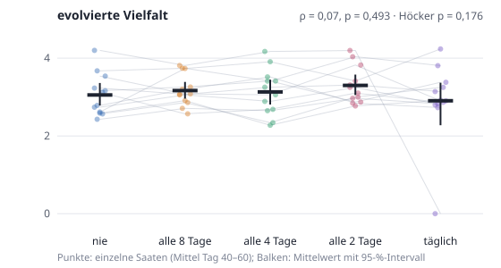
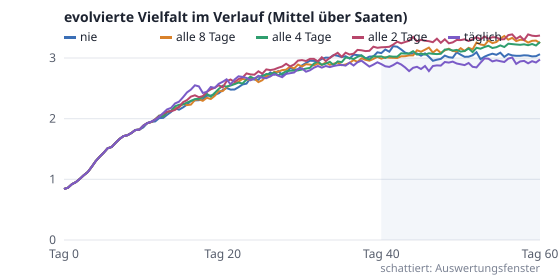

# Ist die Vielfalt bei mittlerer Störung am größten?

**Hypothese.** Die evolvierte Vielfalt (Erbgut-Abstände innerhalb einer Gründerlinie) ist bei mittlerer Störungshäufigkeit höher als ohne und bei sehr häufiger Störung (Intermediate Disturbance Hypothesis nach Connell 1978). Vorab festgelegter Test: Höckerkontrast, also die inneren Stufen gegen den Mittelwert der beiden äußeren.

Eine Störung tötet jedes Tier unabhängig von seinem Zustand mit 50 % Wahrscheinlichkeit, wie ein Sturm. Störungen beginnen an Tag 10, zugleich endet die Einwanderung, damit Störung nicht über Einwanderer indirekt Vielfalt von außen hereinholt.

## Versuchsaufbau

| | |
| --- | --- |
| Faktor | `disturbEvery` mit den Stufen nie (`0`), alle 8 Tage (`8`), alle 4 Tage (`4`), alle 2 Tage (`2`), täglich (`1`) |
| Wiederholungen | 12 Saaten (2000 bis 2011), jede auf jeder Stufe (gepaart) |
| Dauer | 60 Tage, gemessen wird der Mittelwert über Tag 40 bis 60 |
| Weitere Einstellungen | `immigrationUntil` = 10, `disturbFrom` = 10, `disturbStrength` = 0.5 |
| Primäre Messgröße | evolvierte Vielfalt (vorab festgelegt), alle übrigen explorativ |
| Code-Stand | `6046d10`, Node v22.23.5, Rechenzeit 511 s |
| Ausgestorben | 1 von 60 Läufen endeten ohne Tiere (gehen mit 0 in die Mittelwerte ein) |

## Ergebnisse

Mittelwerte mit 95-%-Bootstrap-Intervall. ρ ist Spearmans Rangkorrelation zwischen Stufe und Messwert; ihr p-Wert stammt aus einer Permutation der Stufen innerhalb jeder Saat. Der Höckertest vergleicht je Saat die inneren Stufen mit den beiden äußeren. Die p-Werte sind zusätzlich nach Holm über alle Messgrößen korrigiert.

| Messgröße | nie | alle 8 Tage | alle 4 Tage | alle 2 Tage | täglich | ρ | Höcker [95 %] | p Höcker | p | p (Holm) |
| --- | --- | --- | --- | --- | --- | --- | --- | --- | --- | --- |
| **evolvierte Vielfalt** | 3,05 [2,78; 3,36] | 3,17 [2,96; 3,39] | 3,13 [2,81; 3,45] | 3,30 [3,05; 3,58] | 2,90 [2,27; 3,37] | 0,07 | 0,22 [-0,02; 0,55] | 0,176 | 0,493 | 0,527 |
| genetische Vielfalt | 3,17 [2,81; 3,60] | 3,20 [2,99; 3,42] | 3,22 [2,87; 3,58] | 3,33 [3,06; 3,63] | 2,90 [2,27; 3,37] | 0,05 | 0,21 [-0,03; 0,55] | 0,201 | 0,664 | 0,527 |
| Gründerlinien | 1,19 [1,00; 1,52] | 1,09 [1,00; 1,27] | 1,12 [1,00; 1,37] | 1,13 [1,00; 1,40] | 0,92 [0,75; 1,00] | -0,22 | 0,06 [-0,02; 0,16] | 0,500 | 0,008 | 0,040 |
| Artenzahl | 16,96 [14,26; 19,60] | 16,34 [13,68; 19,05] | 18,85 [14,18; 23,65] | 23,34 [19,52; 27,21] | 25,97 [19,51; 31,52] | 0,43 | -1,96 [-4,52; 0,91] | 0,218 | < 0,001 | < 0,001 |
| effektive Arten | 7,21 [5,65; 8,85] | 8,24 [6,81; 9,67] | 8,71 [6,35; 11,31] | 10,94 [9,10; 12,89] | 12,77 [9,43; 16,06] | 0,47 | -0,69 [-1,89; 0,62] | 0,352 | < 0,001 | < 0,001 |
| Tiere | 634,68 [525,95; 752,13] | 505,65 [426,87; 581,84] | 599,04 [475,93; 720,05] | 585,39 [479,14; 685,15] | 521,21 [398,21; 627,64] | -0,05 | -14,58 [-72,77; 41,70] | 0,646 | 0,560 | 0,560 |
| Größe ⌀ | 4,10 [3,77; 4,49] | 4,38 [3,99; 4,82] | 4,11 [3,75; 4,52] | 3,90 [3,62; 4,22] | 3,15 [2,55; 3,51] | -0,52 | 0,50 [0,16; 0,89] | 0,010 | < 0,001 | < 0,001 |
| Mutationsrate ⌀ | 0,08 [0,07; 0,09] | 0,08 [0,07; 0,10] | 0,08 [0,06; 0,10] | 0,08 [0,06; 0,10] | 0,06 [0,05; 0,08] | -0,22 | 0,01 [-0,00; 0,03] | 0,188 | 0,016 | 0,066 |

## Dateien

- `runs.csv`: ein Lauf pro Zeile, mit den Fenster-Mittelwerten aller Messgrößen
- `timeseries.csv`: alle Messungen aller Läufe (alle halbe Tage)
- `manifest.json`: vollständige Parameter je Stufe, Saaten, Code-Stand
- `<messgröße>.svg`: Einzelwerte je Saat, Mittelwert und 95-%-Intervall

Neu erzeugen: `node tools/experiment.mjs experiments/stoerung.json`
